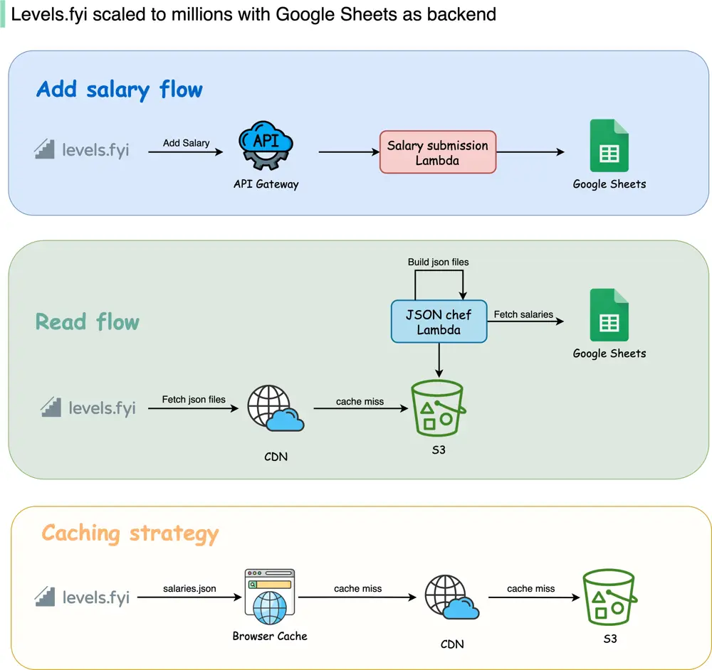

# ByteByteGo System Design 101: How Levelsfyi Scaled to Millions of Users with Google Sheets

> Copied from <https://github.com/ByteByteGoHq/system-design-101> (CC BY-NC-ND 4.0, by ByteByteGo). Questions and answers are the source's own; nothing was answered or rewritten here.

I read something unbelievable today: Levelsfyi scaled to millions of users using Google Sheets as a backend!

They started off on Google Forms and Sheets, which helped them reach millions of monthly active users before switching to a proper backend.

To be fair, they do use serverless computing, but using Google Sheets as the database is an interesting choice.

Why do they use Google Sheets as a backend? Using their own words: "It seems like a pretty counterintuitive idea for a site with our traffic volume to not have a backend or any fancy infrastructure, but our philosophy to building products has always been, start simple and iterate. This allows us to move fast and focus on what’s important".
