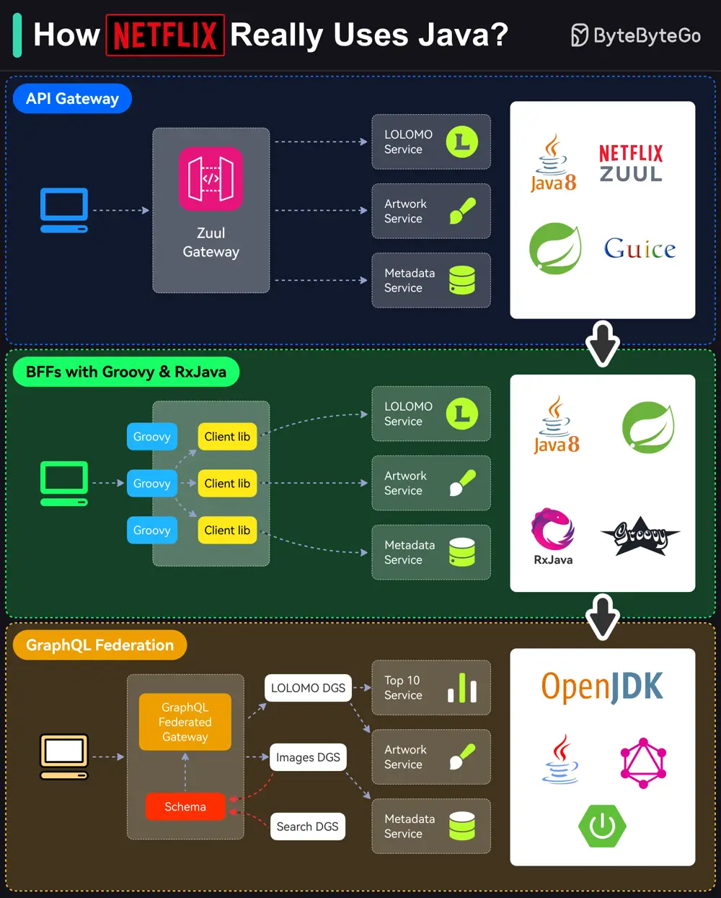

# ByteByteGo System Design 101: How Netflix Really Uses Java

> Copied from <https://github.com/ByteByteGoHq/system-design-101> (CC BY-NC-ND 4.0, by ByteByteGo). Questions and answers are the source's own; nothing was answered or rewritten here.

Netflix is predominantly a Java shop.

Every backend application (including internal apps, streaming, and movie production apps) at Netflix is a Java application.

However, the Java stack is not static and has gone through multiple iterations over the years.

Here are the details of those iterations:

*   **API Gateway**

    Netflix follows a microservices architecture. Every piece of functionality and data is owned by a microservice built using Java (initially version 8)

*   **BFFs with Groovy & RxJava**

    Using a single gateway for multiple clients was a problem for Netflix because each client (such as TV, mobile apps, or web browser) had subtle differences.

    To handle this, Netflix used the Backend-for-Frontend (BFF) pattern. Zuul was moved to the role of a proxy

*   **GraphQL Federation**

    The Groovy and RxJava approach required more work from the UI developers in creating the Groovy scripts. Also, reactive programming is generally hard.
