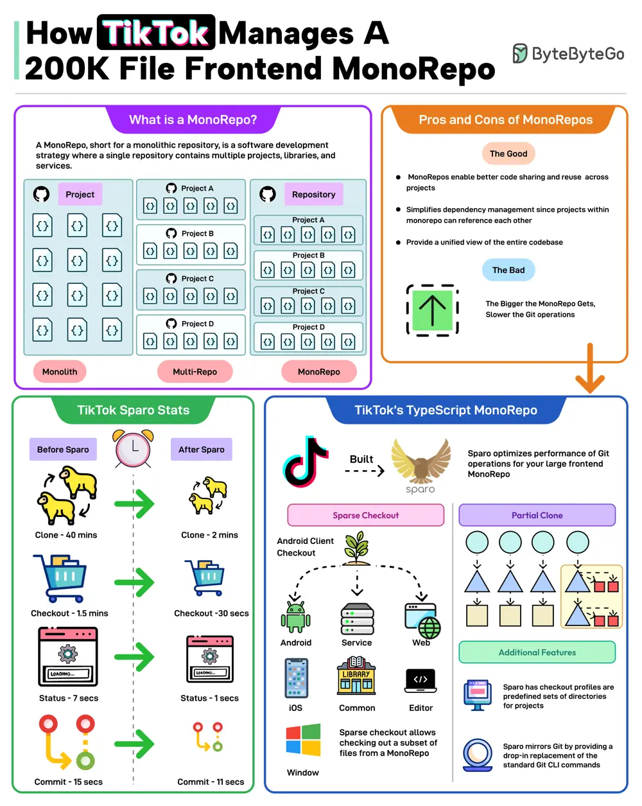

# ByteByteGo System Design 101: How TikTok Manages a 200K File Frontend MonoRepo

> Copied from <https://github.com/ByteByteGoHq/system-design-101> (CC BY-NC-ND 4.0, by ByteByteGo). Questions and answers are the source's own; nothing was answered or rewritten here.

A MonoRepo, short for a monolithic repository, is a software development strategy where a single repository contains multiple projects, libraries, and services.

The good parts of a MonoRepo are:

*   **Better code sharing**
*   **Simplified dependency management**
*   **A unified view of the code base**

However, the bigger the MonoRepo gets, the slower the various Git operations.

TikTok faced a similar change with its frontend TypeScript MonoRepo with 200K files.

To deal with this, TikTok built a tool named Sparo that optimizes the performance of Git operations for large frontend MonoRepos.

Sparo dramatically improved the performance of Git operations. Some stats are as follows

*   Git clone time went from 40 mins to just 2 mins.
*   Checkout went from 1.5 minutes to 30 seconds.
*   Status went from 7 seconds to 1 second.
*   Git commit time went from 15 seconds to 11 seconds.
