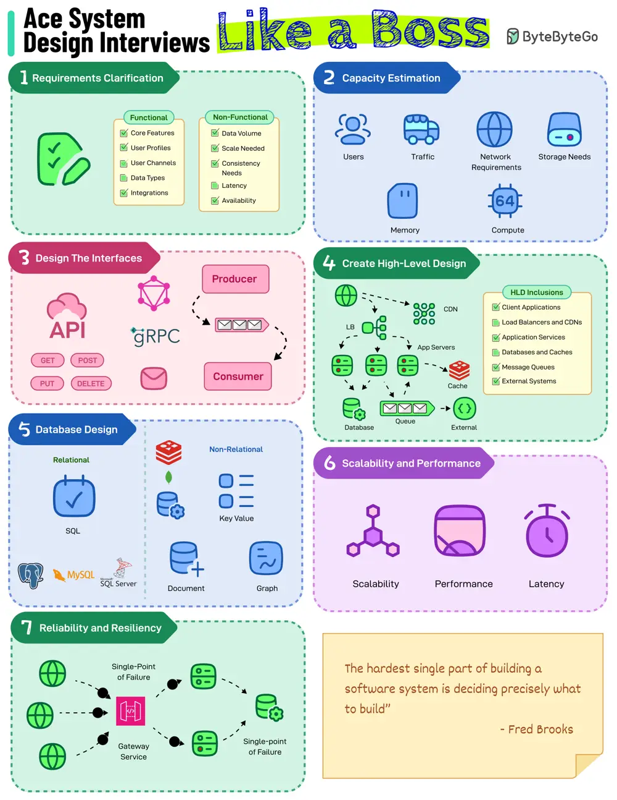

# ByteByteGo System Design 101: How to Ace System Design Interviews

> Copied from <https://github.com/ByteByteGoHq/system-design-101> (CC BY-NC-ND 4.0, by ByteByteGo). Questions and answers are the source's own; nothing was answered or rewritten here.

Follow this 7-step process to do well in a System Design Round

## 1. Requirements Clarification

In the first step, clarify functional and non-functional requirements. Ask questions to understand the core features of the system as well as non-functional aspects such as data volume, availability, scale, etc.

## 2. Capacity Estimation

Next, estimate the capacity of the system. Focus on attributes like the number of users, traffic, storage/memory needs, and compute and networking requirements.

## 3. Create High-Level Design

Break down the system into components such as client apps, servers, load balancers, databases, etc.

Start with drawing a simple block diagram that shows these components and their potential interaction with each other. Focus on the data flow.

## 4. Database Design

Model the data and choose the right database type for the system. Once done, focus on the database schema.

## 5. Interface Design

Next, focus on the interfaces to the system. This could be API endpoints or event models exchanged between the various components of the system. Also, choose a communication approach such as REST, GraphQL, gRPC, or an event-driven

## 6. Scalability and Performance

Address the scalability, performance, and latency aspects of the system by suggesting techniques that will be used. For example, vertical and horizontal scaling, caching, indexing, denormalizing, sharding, replication, CDNs, etc.

## 7. Reliability and Resiliency

Lastly, address the reliability and resiliency of the design. Identify single points of failure and mitigate their impact.
