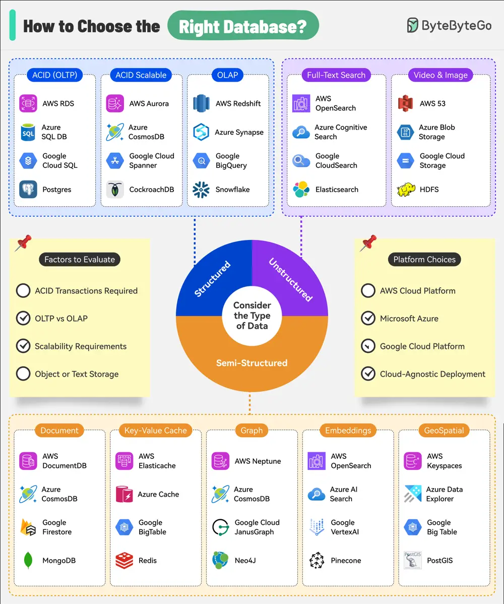

# ByteByteGo System Design 101: How to Choose the Right Database

> Copied from <https://github.com/ByteByteGoHq/system-design-101> (CC BY-NC-ND 4.0, by ByteByteGo). Questions and answers are the source's own; nothing was answered or rewritten here.

*   OLTP: For transactional systems requiring strong consistency

*   OLAP: Optimized for complex queries and data analysis

*   Full-Text Search: Fast, flexible text search capabilities

*   Document Stores: JSON-like document storage and querying

*   Key-Value Stores: High-speed, simple data models

*   Graph Databases: Managing highly connected data

*   Embeddings: Efficient storage and retrieval of vector representations

*   Geospatial: Specialized for location-based data and queries
