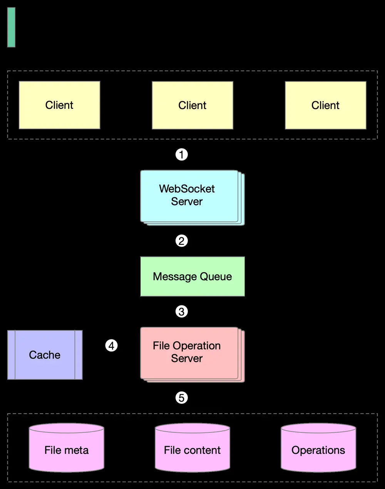

# ByteByteGo System Design 101: How to Design Google Docs

> Copied from <https://github.com/ByteByteGoHq/system-design-101> (CC BY-NC-ND 4.0, by ByteByteGo). Questions and answers are the source's own; nothing was answered or rewritten here.

1. Clients send document editing operations to the WebSocket Server.

2. The real-time communication is handled by the WebSocket Server.

3. Documents operations are persisted in the Message Queue.

4. The File Operation Server consumes operations produced by clients and generates transformed operations using collaboration algorithms.

5. Three types of data are stored: file metadata, file content, and operations.

One of the biggest challenges is real-time conflict resolution. Common algorithms include:

*   Operational transformation (OT)
*   Differential Synchronization (DS)
*   Conflict-free replicated data type (CRDT)

Google Doc uses OT according to its Wikipedia page and CRDT is an active area of research for real-time concurrent editing.
