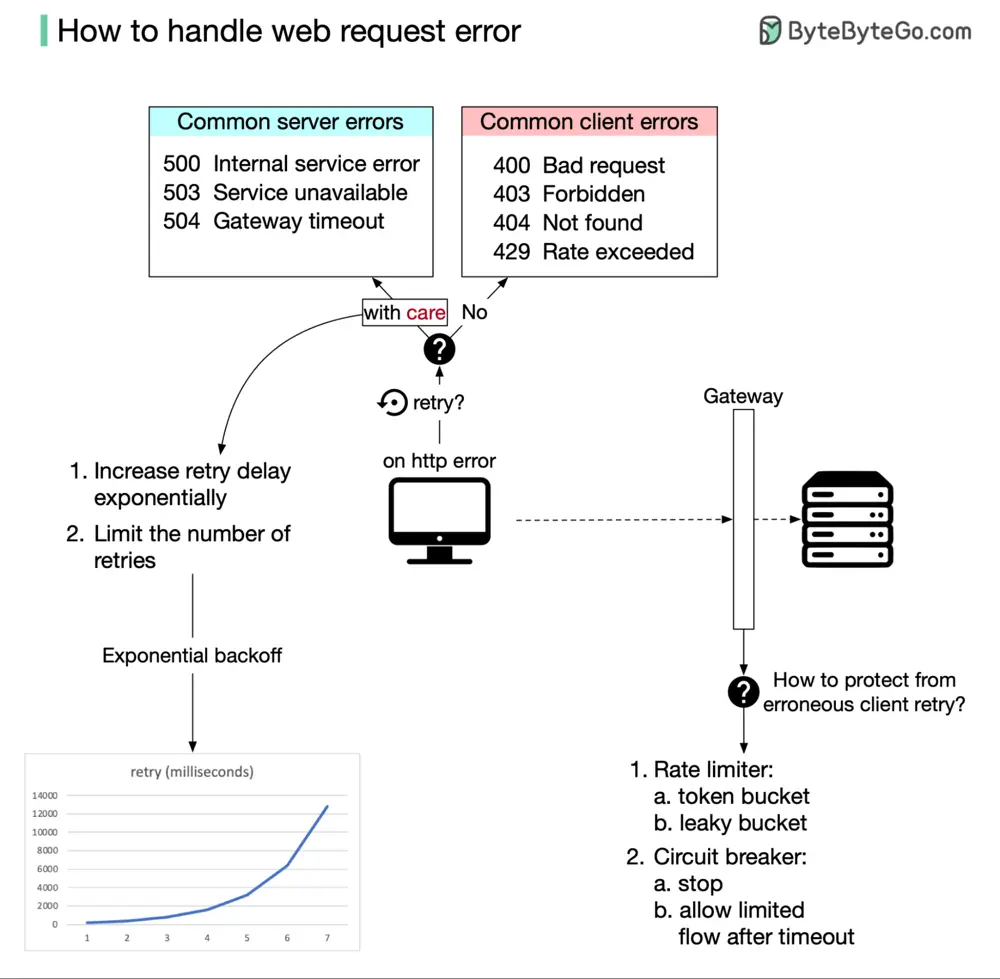

# ByteByteGo System Design 101: How to Handle Web Request Errors

> Copied from <https://github.com/ByteByteGoHq/system-design-101> (CC BY-NC-ND 4.0, by ByteByteGo). Questions and answers are the source's own; nothing was answered or rewritten here.

How do we properly deal with HTTP errors on the browser side? And how do we handle them correctly on the server side when the client side is at fault?

From the browser's point of view, the easiest thing to do is to try again and hope the error just goes away. This is a good idea in a distributed network, but we also have to be very careful not to make things worse. Here’s two general rules:

*   For 4XX HTTP error code, do not retry.

*   For 5XX HTTP error code, try again carefully.

So which things should we do carefully in the browser? We definitely should not overwhelm the server with retried requests. An algorithm named exponential backoff might be able to help. It controls two things:

*   The latency between two retries. The latency will increase exponentially.

*   The number of retries is usually capped.

Will all browsers handle their retry logic in a graceful way? Most likely not. So the server has to take care of its own safety. A common way to control the flow of HTTP requests is to set up a flow control gateway in front of the server. This provides two useful tools:

*   **Rate limiter:** which limits how often a request can be made. It has two slightly different choices; the token bucket and the leaky bucket.

*   **Circuit breaker:** This will stop the HTTP flow immediately when the error threshold is exceeded. After a set amount of time, it will only let a limited amount of HTTP traffic through. If everything works well, it will slowly let all HTTP traffic through.

We should be able to handle intermittent errors effectively with exponential backoff in the browser and with a flow control gateway on the server side. Any remaining issues are real errors that need to be fixed carefully.
