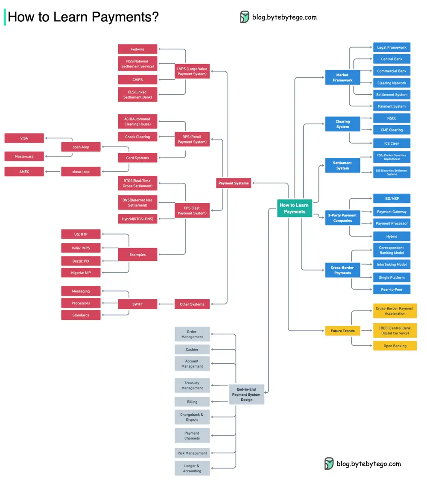

# ByteByteGo System Design 101: How to Learn Payments

> Copied from <https://github.com/ByteByteGoHq/system-design-101> (CC BY-NC-ND 4.0, by ByteByteGo). Questions and answers are the source's own; nothing was answered or rewritten here.

The mind map below shows an extensive outline of payment knowledge.

This gives us 𝐚 𝐭𝐨𝐩-𝐝𝐨𝐰𝐧 𝐯𝐢𝐞𝐰 𝐨𝐟 𝐭𝐡𝐞 𝐢𝐧𝐝𝐮𝐬𝐭𝐫𝐲 and an overview of how the payment systems work.

Notice that different countries have different payment frameworks. But in general, the payment industry is composed of below parts:

*   Regulatory Authority

*   Central Bank

*   Commercial Banks

*   Non-Bank Payment Companies

*   Payment Systems

*   Clearing Networks

*   Settlement Systems

## More Useful Materials

Here are some useful materials for your reference:

*   Payment Systems in the U.S. by GlenBrook

*   BIS (Bank for International Settlements) Website

*   PayPal documents

*   Stripe documents

*   SWIFT documents
