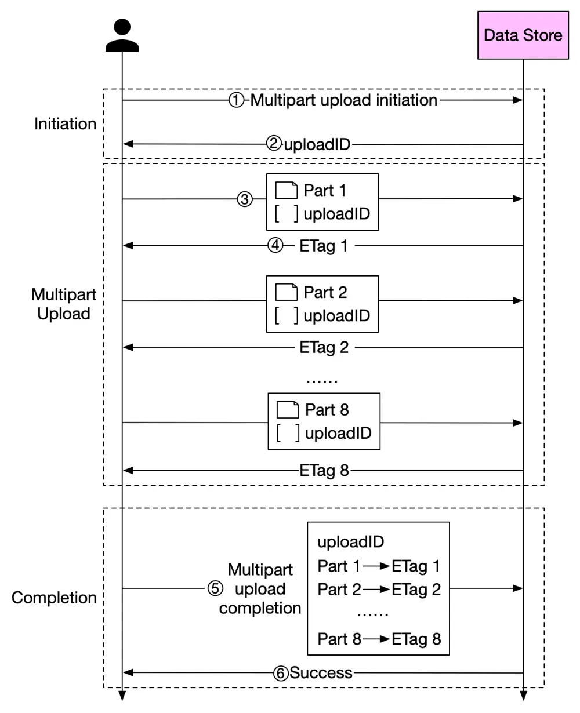

# ByteByteGo System Design 101: How to Upload a Large File to S3

> Copied from <https://github.com/ByteByteGoHq/system-design-101> (CC BY-NC-ND 4.0, by ByteByteGo). Questions and answers are the source's own; nothing was answered or rewritten here.

How can we optimize performance when we **upload large files** to object storage service such as S3?

Before we answer this question, let's take a look at why we need to optimize this process. Some files might be larger than a few GBs. It is possible to upload such a large object file directly, but it could take a long time. If the network connection fails in the middle of the upload, we have to start over. A better solution is to slice a large object into smaller parts and upload them independently. After all the parts are uploaded, the object store re-assembles the object from the parts. This process is called **multipart upload**.

The diagram above illustrates how multipart upload works:

1.  The client calls the object storage to initiate a multipart upload.

2.  The data store returns an uploadID, which uniquely identifies the upload.

3.  The client splits the large file into small objects and starts uploading. Let’s assume the size of the file is 1.6GB and the client splits it into 8 parts, so each part is 200 MB in size. The client uploads the first part to the data store together with the uploadID it received in step 2.

4.  When a part is uploaded, the data store returns an ETag, which is essentially the md5 checksum of that part. It is used to verify multipart uploads.

5.  After all parts are uploaded, the client sends a complete multipart upload request, which includes the uploadID, part numbers, and ETags.

6.  The data store reassembles the object from its parts based on the part number. Since the object is really large, this process may take a few minutes. After reassembly is complete, it returns a success message to the client.
