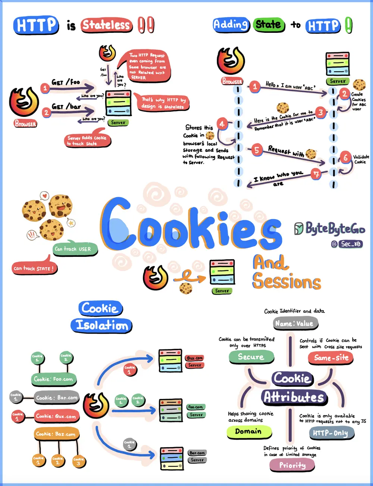

# ByteByteGo System Design 101: HTTP Cookies Explained With a Simple Diagram

> Copied from <https://github.com/ByteByteGoHq/system-design-101> (CC BY-NC-ND 4.0, by ByteByteGo). Questions and answers are the source's own; nothing was answered or rewritten here.

HTTP, the language of the web, is naturally "stateless." But hey, we all want that seamless, continuous browsing experience, right? Enter the unsung heroes - Cookies!

So, here's the scoop in this cookie flyer:

*   HTTP is like a goldfish with no memory - it forgets you instantly! But cookies swoop in to the rescue, adding that "session secret sauce" to your web interactions.

*   Cookies? Think of them as little notes you pass to the web server, saying, "Remember me, please!" And yes, they're stored there, like cherished mementos.

*   Browsers are like cookie bouncers, making sure your cookies don't party crash at the wrong website.

*   Finally, meet the cookie celebrities - SameSite, Name, Value, Secure, Domain, and HttpOnly. They're the cool kids setting the rules in the cookie jar!
