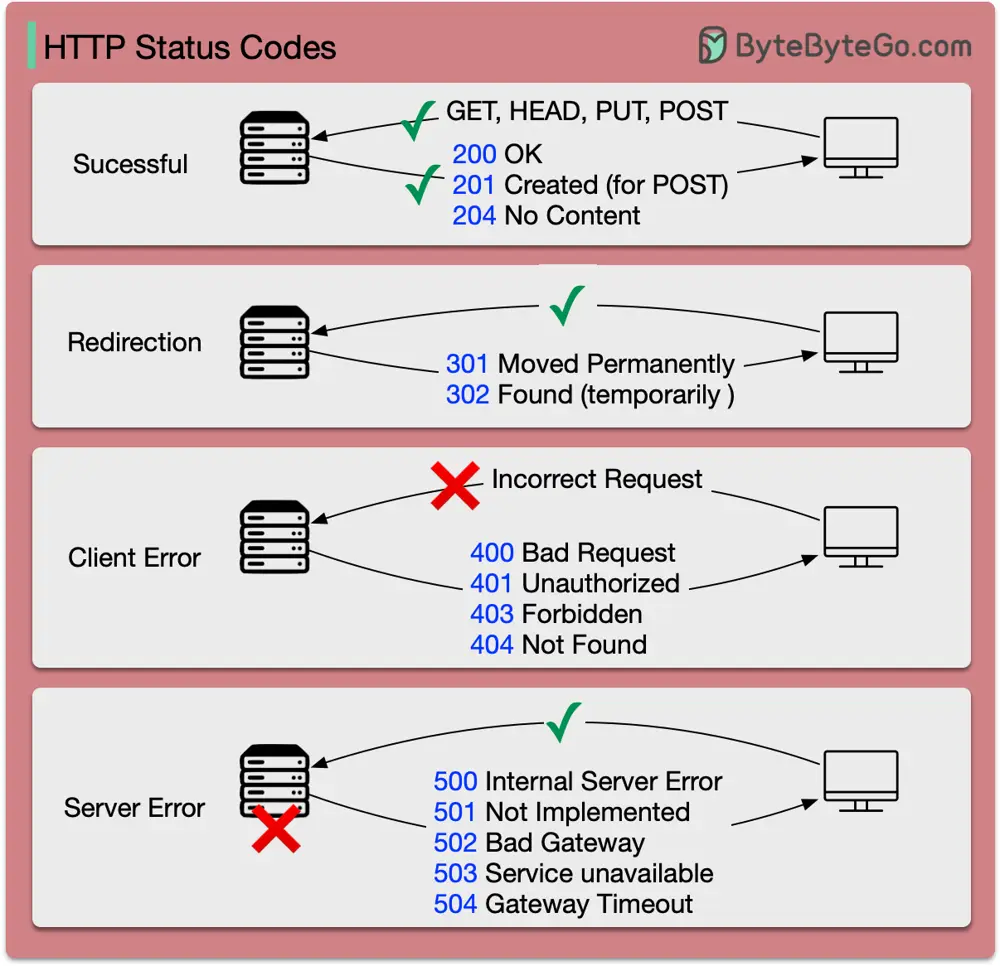

# ByteByteGo System Design 101: HTTP Status Codes You Should Know

> Copied from <https://github.com/ByteByteGoHq/system-design-101> (CC BY-NC-ND 4.0, by ByteByteGo). Questions and answers are the source's own; nothing was answered or rewritten here.

The response codes for HTTP are divided into five categories:

*   **Informational (100-199)**
*   **Success (200-299)**
*   **Redirection (300-399)**
*   **Client Error (400-499)**
*   **Server Error (500-599)**
