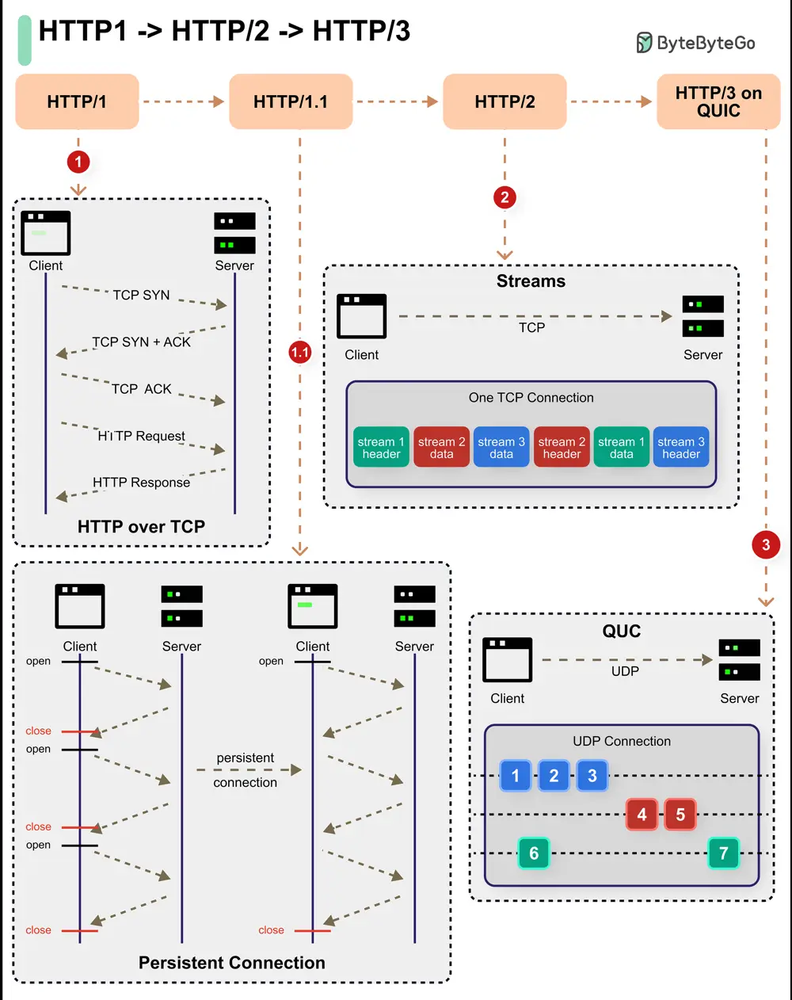

# ByteByteGo System Design 101: HTTP/1 -> HTTP/2 -> HTTP/3

> Copied from <https://github.com/ByteByteGoHq/system-design-101> (CC BY-NC-ND 4.0, by ByteByteGo). Questions and answers are the source's own; nothing was answered or rewritten here.

HTTP 1 started in 1996 followed by HTTP 1.1 the very next year. In 2015, HTTP 2 came about and in 2019 we got HTTP 3.

With each iteration, the protocol has evolved in new and interesting ways.

*   **HTTP 1** (and its sub-versions) introduced features like persistent connections, pipelining, and the concept of headers. The protocol was built on top of TCP and provided a reliable way of communication over the World Wide Web. It is still used despite being over 25 years old.
*   **HTTP 2** brought new features such as multiplexing, stream prioritization, server push, and HPACK compression. However, it still used TCP as the underlying protocol.
*   **HTTP 3** uses Google’s QUIC, which is built on top of UDP. In other words, HTTP 3 has moved away from TCP.
