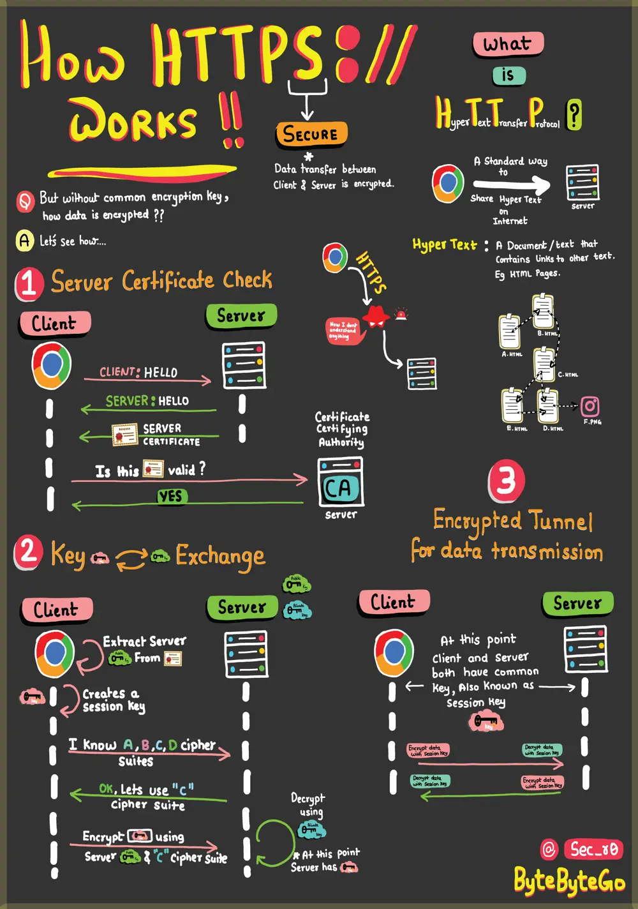

# ByteByteGo System Design 101: HTTPS, SSL Handshake, and Data Encryption Explained

> Copied from <https://github.com/ByteByteGoHq/system-design-101> (CC BY-NC-ND 4.0, by ByteByteGo). Questions and answers are the source's own; nothing was answered or rewritten here.

HTTPS: Safeguards your data from eavesdroppers and breaches. Understand how encryption and digital certificates create an impregnable shield.

SSL Handshake: Behind the Scenes — Witness the cryptographic protocols that establish a secure connection. Experience the intricate exchange of keys and negotiation.

Secure Data Transmission: Navigating the Tunnel — Journey through the encrypted tunnel forged by HTTPS. Learn how your information travels while shielded from cyber threats.

HTML's Role: Peek into HTML's role in structuring the web. Uncover how hyperlinks and content come together seamlessly. And why is it called HYPER TEXT.
