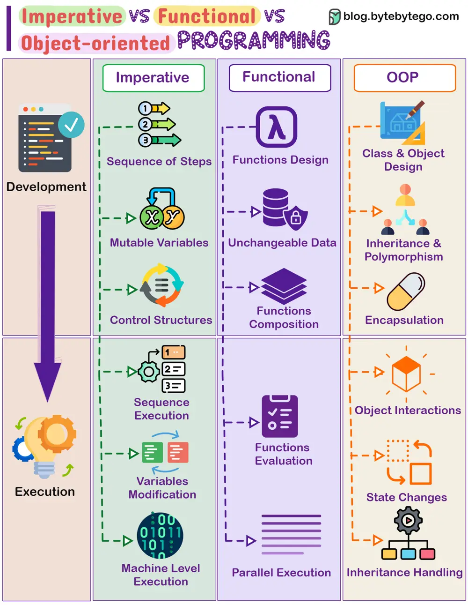

# ByteByteGo System Design 101: Imperative vs Functional vs Object-oriented Programming

> Copied from <https://github.com/ByteByteGoHq/system-design-101> (CC BY-NC-ND 4.0, by ByteByteGo). Questions and answers are the source's own; nothing was answered or rewritten here.

In software development, different programming paradigms offer unique ways to structure code. Three main paradigms are Imperative, Functional, and Object-oriented programming, each with distinct approaches to problem-solving.

## Imperative Programming

*   Works by changing program state through a sequence of commands.

*   Uses control structures like loops and conditional statements for execution flow.

*   Emphasizes mutable data and explicit steps for task completion.

*   Examples: C, Python, and most procedural languages.

## Functional Programming

*   Relies on pure functions, emphasizing computation without side effects.

*   Promotes immutability and the avoidance of mutable state.

*   Supports higher-order functions, recursion, and declarative programming.

*   Examples: Haskell, Lisp, Scala, and functional features in languages like JavaScript.

## Object-oriented Programming

*   Focuses on modeling real-world entities as objects, containing data and methods.

*   Encourages concepts such as inheritance, encapsulation, and polymorphism.

*   Utilizes classes, objects, and interfaces to structure code.

*   Examples: Java, C++, Python, and Ruby.
