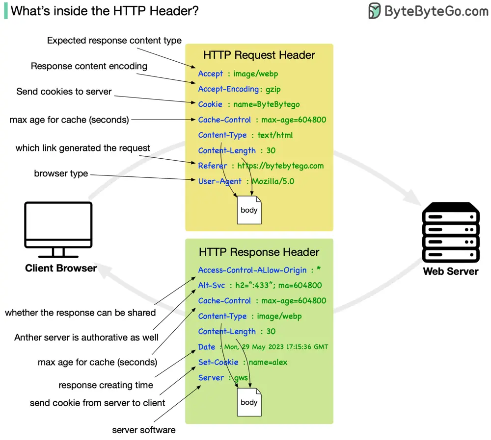

# ByteByteGo System Design 101: Important Things About HTTP Headers

> Copied from <https://github.com/ByteByteGoHq/system-design-101> (CC BY-NC-ND 4.0, by ByteByteGo). Questions and answers are the source's own; nothing was answered or rewritten here.

HTTP requests are like asking for something from a server, and HTTP responses are the server's replies. It's like sending a message and receiving a reply.

An HTTP request header is an extra piece of information you include when making a request, such as what kind of data you are sending or who you are. In response headers, the server provides information about the response it is sending you, such as what type of data you're receiving or if you have special instructions.

A header serves a vital role in enabling client-server communication when building RESTful applications. In order to send the right information with their requests and interpret the server's responses correctly, you need to understand these headers.
