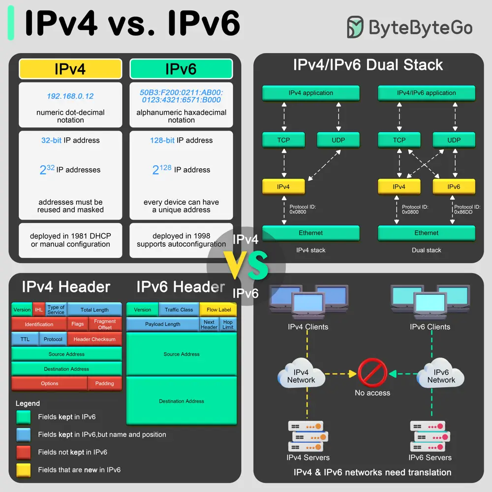

# ByteByteGo System Design 101: IPv4 vs. IPv6: Differences

> Copied from <https://github.com/ByteByteGoHq/system-design-101> (CC BY-NC-ND 4.0, by ByteByteGo). Questions and answers are the source's own; nothing was answered or rewritten here.

The transition from Internet Protocol version 4 (IPv4) to Internet Protocol version 6 (IPv6) is primarily driven by the need for more internet addresses, alongside the desire to streamline certain aspects of network management.

## Format and Length

IPv4 uses a 32-bit address format, which is typically displayed as four decimal numbers separated by dots (e.g., 192.168.0.12). The 32-bit format allows for approximately 4.3 billion unique addresses, a number that is rapidly proving insufficient due to the explosion of internet-connected devices.

In contrast, IPv6 utilizes a 128-bit address format, represented by eight groups of four hexadecimal digits separated by colons (e.g., 50B3:F200:0211:AB00:0123:4321:6571:B000). This expansion allows for approximately much more addresses, ensuring the internet's growth can continue unabated.

## Header

The IPv4 header is more complex and includes fields such as the header length, service type, total length, identification, flags, fragment offset, time to live (TTL), protocol, header checksum, source and destination IP addresses, and options.

IPv6 headers are designed to be simpler and more efficient. The fixed header size is 40 bytes and includes less frequently used fields in optional extension headers. The main fields include version, traffic class, flow label, payload length, next header, hop limit, and source and destination addresses. This simplification helps improve packet processing speeds.

## Translation between IPv4 and IPv6

As the internet transitions from IPv4 to IPv6, mechanisms to allow these protocols to coexist have become essential:

*   **Dual Stack:** This technique involves running IPv4 and IPv6 simultaneously on the same network devices. It allows seamless communication in both protocols, depending on the destination address availability and compatibility. The dual stack is considered one of the best approaches for the smooth transition from IPv4 to IPv6.
