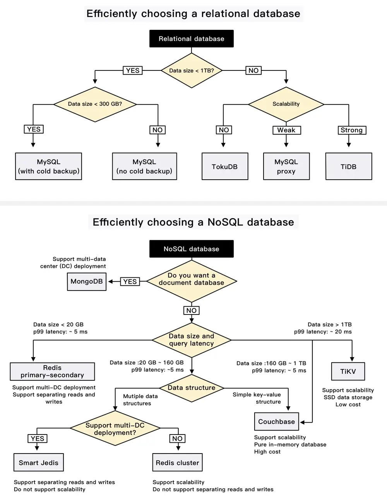

# ByteByteGo System Design 101: iQIYI Database Selection Trees

> Copied from <https://github.com/ByteByteGoHq/system-design-101> (CC BY-NC-ND 4.0, by ByteByteGo). Questions and answers are the source's own; nothing was answered or rewritten here.

One picture is worth a thousand words.

iQIYI is one of the largest online video sites in the world, with over 500 million monthly active users. Let's look at how they choose relational and NoSQL databases.

The following databases are used at iQIYI:

*   MySQL
*   Redis
*   TiDB: a hybrid transactional/analytical processing (HTAP) distributed database
*   Couchbase: distributed multi-model NoSQL document-oriented database
*   TokuDB: open-source storage engine for MySQL and MariaDB.
*   Big data analytical systems, like Hive and Impala
*   Other databases, like MongoDB, HiGraph, and TiKV

The database selection trees below explain how they choose a database.
