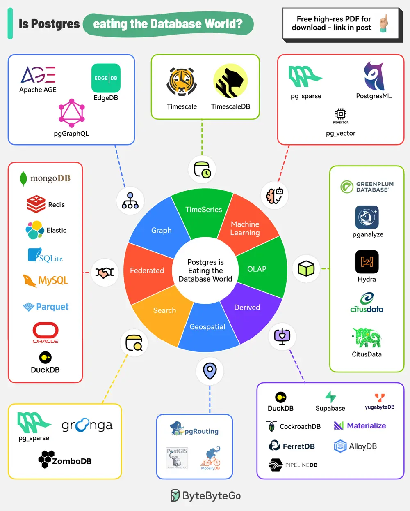

# ByteByteGo System Design 101: Is PostgreSQL Eating the Database World?

> Copied from <https://github.com/ByteByteGoHq/system-design-101> (CC BY-NC-ND 4.0, by ByteByteGo). Questions and answers are the source's own; nothing was answered or rewritten here.

It seems that no matter what the use case, PostgreSQL supports it. When in doubt, you can simply use PostgreSQL.

## PostgreSQL Capabilities

*   **TimeSeries**

    PostgreSQL embraces Timescale, a powerful time-series database extension for efficient handling of time-stamped data.

*   **Machine Learning**

    With pgVector and PostgresML, Postgres can support machine learning capabilities and vector similarity searches.

*   **OLAP**

    Postgres can support OLAP with tools such as Hydra, Citus, and pg\_analytics.

*   **Derived**

    Even derived databases such as DuckDB, FerretDB, CockroachDB, AlloyDB, YugaByte DB, Supabase, etc provide PostgreSQL.

*   **GeoSpatial**

    PostGIS extends PostgreSQL with geospatial capabilities, enabling you to easily store, query, and analyze geographic data.

*   **Search**

    Postgres extensions like pgroonga, ParadeDB, and ZomboDB provide full-text search, text indexing, and data parsing capabilities.

*   **Federated**

    Postgres seamlessly integrates with various data sources such as MongoDB, MySQL, Redis, Oracle, ParquetDB, SQLite, etc, enabling federated querying and data access.

*   **Graph**

    Apache AGE and EdgeDB are graph databases built on top of PostgreSQL. Also, pg\_graphql is an extension that provides GraphQL support for Postgres.
