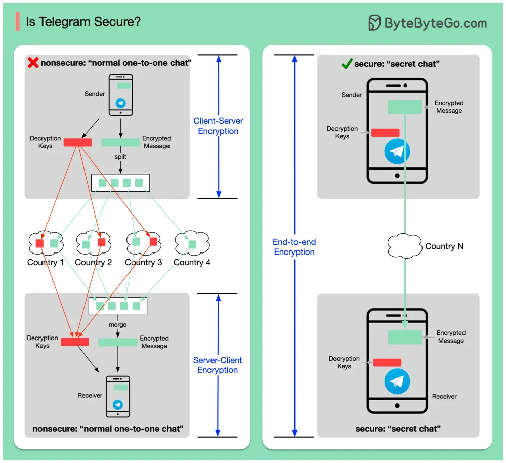

# ByteByteGo System Design 101: Is Telegram Secure?

> Copied from <https://github.com/ByteByteGoHq/system-design-101> (CC BY-NC-ND 4.0, by ByteByteGo). Questions and answers are the source's own; nothing was answered or rewritten here.

Let’s first define what “secure” means. A “secure” chat in a messaging App generally means the message is encrypted at the sender side and is only decryptable at the receiver side. It is also called “E2EE” (end-to-end encryption).

𝐓𝐞𝐥𝐞𝐠𝐫𝐚𝐦'𝐬 𝐮𝐬𝐮𝐚𝐥 𝐩𝐫𝐢𝐯𝐚𝐭𝐞 𝐚𝐧𝐝 𝐠𝐫𝐨𝐮𝐩 𝐜𝐡𝐚𝐭𝐬 𝐚𝐫𝐞𝐧'𝐭 𝐞𝐧𝐝-𝐭𝐨-𝐞𝐧𝐝 𝐞𝐧𝐜𝐫𝐲𝐩𝐭𝐞𝐝

It generally means third parties can intercept and read your messages. Telegram uses the following approach for security:

*   The encrypted message is stored in Telegram servers, but split into several pieces and stored in different countries.
*   The decryption keys are also split and saved in different countries.

This means the hacker needs to get message chunks and keys from all places. It is possible but extremely difficult.

𝐒𝐞𝐜𝐫𝐞𝐭 𝐜𝐡𝐚𝐭𝐬 𝐚𝐫𝐞 𝐞𝐧𝐝-𝐭𝐨-𝐞𝐧𝐝 𝐞𝐧𝐜𝐫𝐲𝐩𝐭𝐞𝐝

If you choose the “secret chat” option, it is end-to-end encrypted. It has several limitations:

*   It doesn’t support group chat or normal one-to-one chat.
*   It is only enabled for mobile devices.
