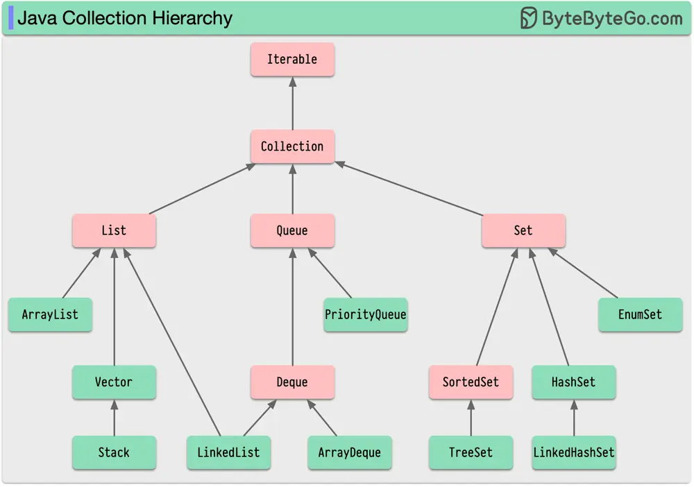

# ByteByteGo System Design 101: Java Collection Hierarchy

> Copied from <https://github.com/ByteByteGoHq/system-design-101> (CC BY-NC-ND 4.0, by ByteByteGo). Questions and answers are the source's own; nothing was answered or rewritten here.

Are you familiar with the Java Collection Framework?

Every Java engineer has encountered the Java Collections Framework (JCF) at some point in their career. It has enabled us to solve complex problems in an efficient and standardized manner.

JCF is built upon a set of interfaces that define the basic operations for common data structures such as lists, sets, and maps. Each data structure is implemented by several concrete classes, which provide specific functionality.

Java Collections are based on the Collection interface. A collection class should support basic operations such as adding, removing, and querying elements.

Through the enhanced for-loop or iterators, the Collection interface extends the Iterable interface, making it convenient to iterate over the elements.

The Collection interface has three main subinterfaces: List, Set, and Queue. Each of these interfaces has its unique characteristics and use cases.

Java engineers need to be familiar with the Java Collection hierarchy to make informed decisions when choosing the right data structure for a particular problem.

We can write more efficient and maintainable code by familiarizing ourselves with the key interfaces and their implementations. We will undoubtedly benefit from mastering the JCF as it is a versatile and powerful tool in our Java arsenal.
