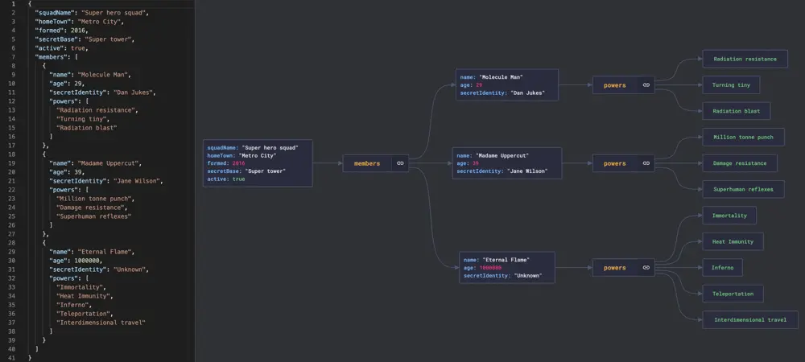

# ByteByteGo System Design 101: JSON Crack: Visualize JSON Files

> Copied from <https://github.com/ByteByteGoHq/system-design-101> (CC BY-NC-ND 4.0, by ByteByteGo). Questions and answers are the source's own; nothing was answered or rewritten here.

If you use JSON files, you'll probably like this tool 👇

Nested JSON files are hard to read.

JsonCrack generates graph diagrams from JSON files and makes them easy to read.
