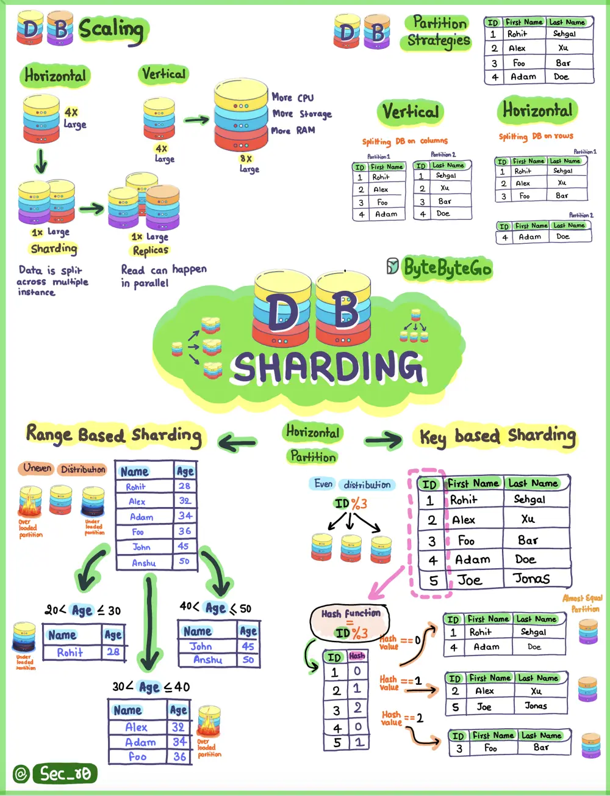

# ByteByteGo System Design 101: Key Concepts to Understand Database Sharding

> Copied from <https://github.com/ByteByteGoHq/system-design-101> (CC BY-NC-ND 4.0, by ByteByteGo). Questions and answers are the source's own; nothing was answered or rewritten here.

In this concise and visually engaging resource, we break down the key concepts of database partitioning, explaining both vertical and horizontal strategies.

## Range-Based Sharding

Splitting your data into distinct ranges. Think of it as organizing your books by genre on separate shelves.

## Key-Based Sharding (with a dash of %3 hash)

Imagine each piece of data having a unique key, and we distribute them based on a specific rule. It's like sorting your playing cards by suit and number.

## Directory-Based Sharding

A directory, like a phone book, helps you quickly find the information you need. Similarly, this technique uses a directory to route data efficiently.
