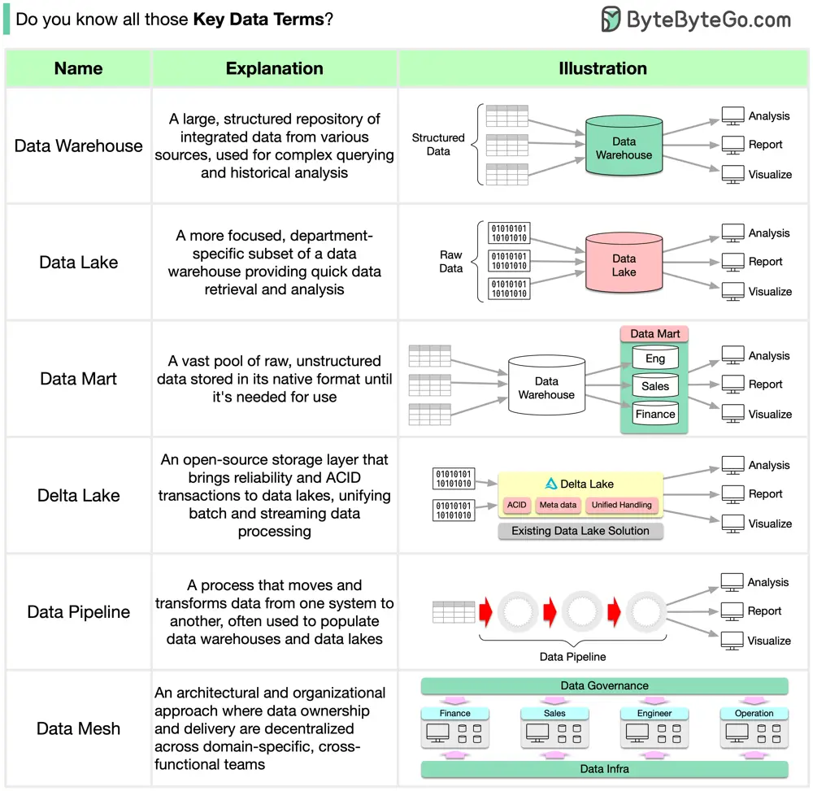

# ByteByteGo System Design 101: Key Data Terms

> Copied from <https://github.com/ByteByteGoHq/system-design-101> (CC BY-NC-ND 4.0, by ByteByteGo). Questions and answers are the source's own; nothing was answered or rewritten here.

Data is used everywhere, but do you know all the commonly used data terms?

- **Data Warehouse:** A large, structured repository of integrated data from various sources, used for complex querying and historical analysis.
- **Data Mart:** A more focused, department-specific subset of a data warehouse providing quick data retrieval and analysis.
- **Data Lake:** A vast pool of raw, unstructured data stored in its native format until it's needed for use.
- **Delta Lake:** An open-source storage layer that brings reliability and ACID transactions to data lakes, unifying batch, and streaming data processing.
- **Data Pipeline:** A process that moves and transforms data from one system to another, often used to populate data warehouses and data lakes.
- **Data Mesh:** An architectural and organizational approach where data ownership and delivery are decentralized across domain-specific, cross-functional teams.
