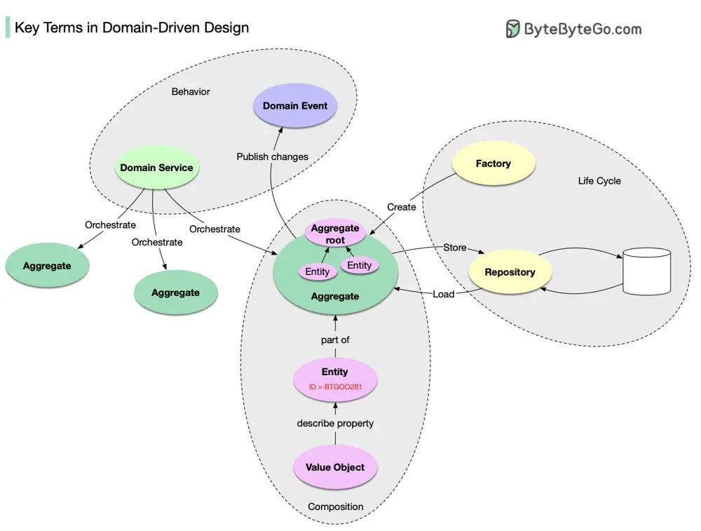

# ByteByteGo System Design 101: Key Terms in Domain-Driven Design

> Copied from <https://github.com/ByteByteGoHq/system-design-101> (CC BY-NC-ND 4.0, by ByteByteGo). Questions and answers are the source's own; nothing was answered or rewritten here.

Have you heard of Domain-Driven Design (DDD), a major software design approach?

DDD was introduced in Eric Evans’ classic book “Domain-Driven Design: Tackling Complexity in the Heart of Software”. It explained a methodology to model a complex business. In this book, there is a lot of content, so I'll summarize the basics.

## The composition of domain objects:

*   **Entity:** a domain object that has ID and life cycle.

*   **Value Object:** a domain object without ID. It is used to describe the property of Entity.

*   **Aggregate:** a collection of Entities that are bounded together by Aggregate Root (which is also an entity). It is the unit of storage.

## The life cycle of domain objects:

*   **Repository:** storing and loading the Aggregate.

*   **Factory:** handling the creation of the Aggregate.

## Behavior of domain objects:

*   **Domain Service:** orchestrate multiple Aggregate.

*   **Domain Event:** a description of what has happened to the Aggregate. The publication is made public so others can consume and reconstruct it.
