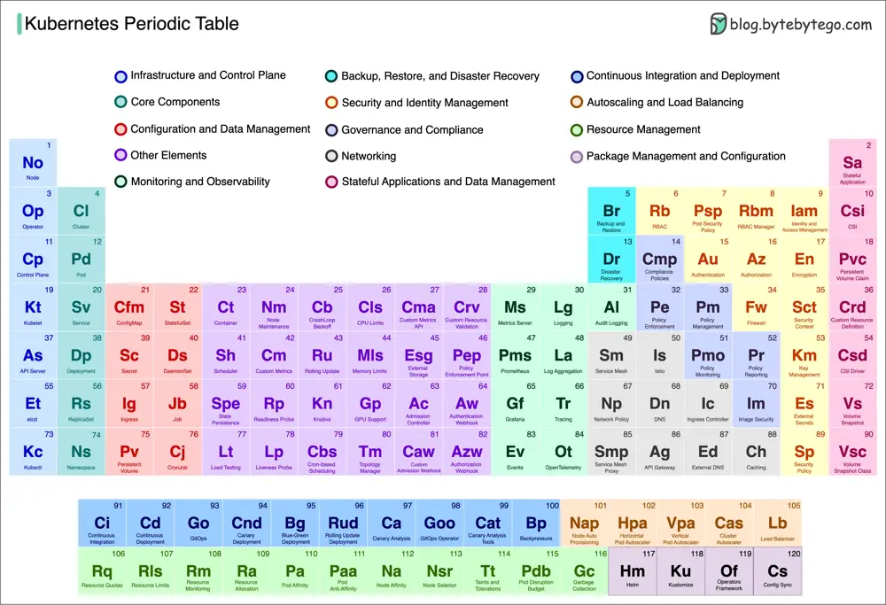

# ByteByteGo System Design 101: Kubernetes Periodic Table

> Copied from <https://github.com/ByteByteGoHq/system-design-101> (CC BY-NC-ND 4.0, by ByteByteGo). Questions and answers are the source's own; nothing was answered or rewritten here.

A comprehensive visual guide that demystifies the key building blocks of this powerful container orchestration platform.

This Kubernetes Periodic Table sheds light on the 120 crucial components that make up the Kubernetes ecosystem.

Whether you're a developer, system administrator, or cloud enthusiast, this handy resource will help you navigate the complex Kubernetes landscape.
