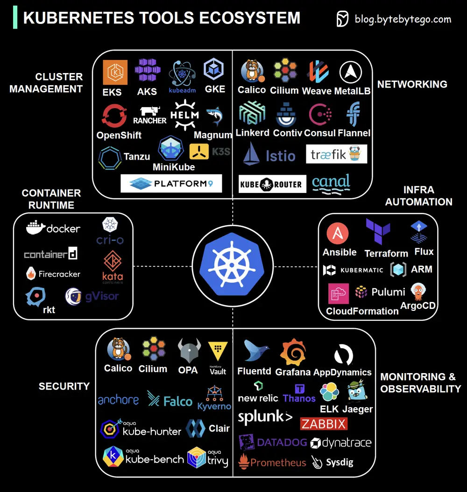

# ByteByteGo System Design 101: Kubernetes Tools Ecosystem

> Copied from <https://github.com/ByteByteGoHq/system-design-101> (CC BY-NC-ND 4.0, by ByteByteGo). Questions and answers are the source's own; nothing was answered or rewritten here.

Kubernetes, the leading container orchestration platform, boasts a vast ecosystem of tools and components that collectively empower organizations to efficiently deploy, manage, and scale containerized applications.

Kubernetes practitioners need to be well-versed in these tools to ensure the reliability, security, and performance of containerized applications within Kubernetes clusters.

To introduce a holistic view of the Kubernetes ecosystem, we've created an illustration covering the aspects of:

*   Security
*   Networking
*   Container Runtime
*   Cluster Management
*   Monitoring and Observability
*   Infrastructure Orchestration
