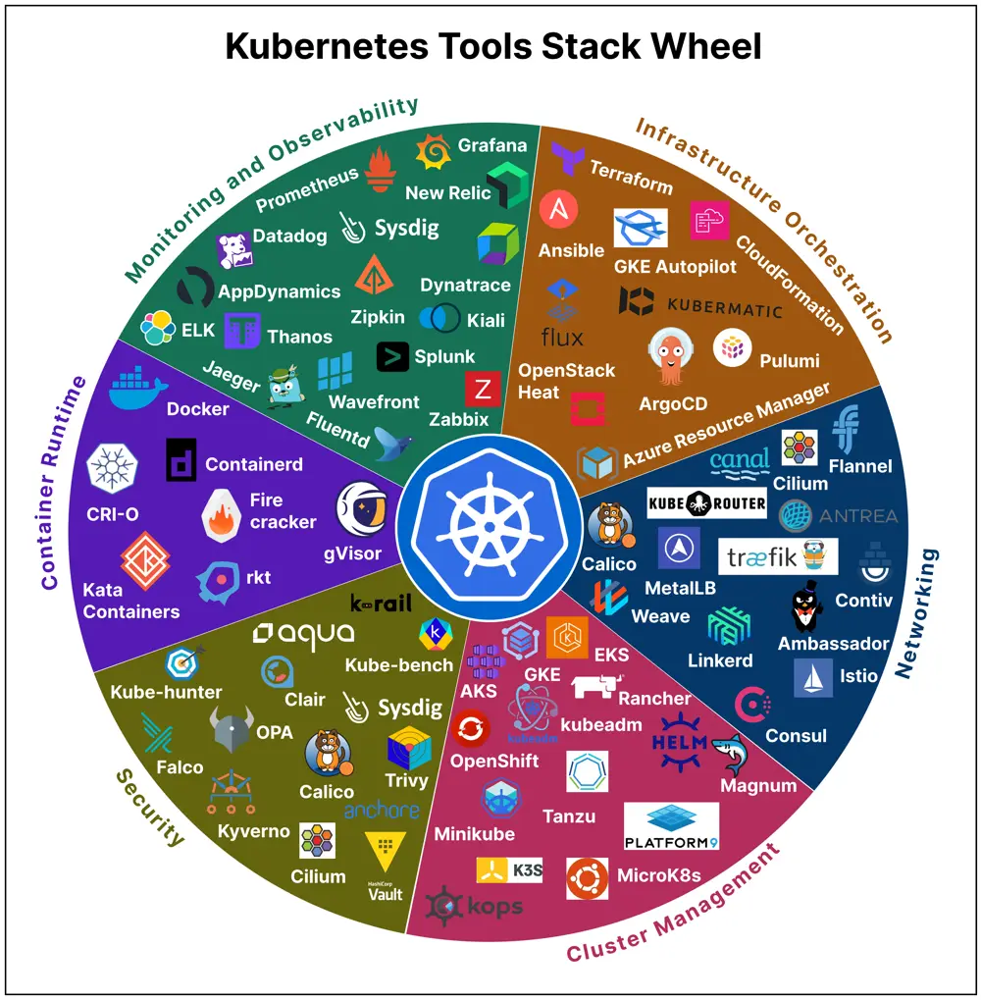

# ByteByteGo System Design 101: Kubernetes Tools Stack Wheel

> Copied from <https://github.com/ByteByteGoHq/system-design-101> (CC BY-NC-ND 4.0, by ByteByteGo). Questions and answers are the source's own; nothing was answered or rewritten here.

Kubernetes tools continually evolve, offering enhanced capabilities and simplifying container orchestration. The innumerable choice of tools speaks about the vastness and the scope of this dynamic ecosystem, catering to diverse needs in the world of containerization.

In fact, getting to know about the existing tools themselves can be a significant endeavor. With new tools and updates being introduced regularly, staying informed about their features, compatibility, and best practices becomes essential for Kubernetes practitioners, ensuring they can make informed decisions and adapt to the ever-changing landscape effectively.

This tool stack streamlines the decision-making process and keeps up with that evolution, ultimately helping you to choose the right combination of tools for your use cases.
