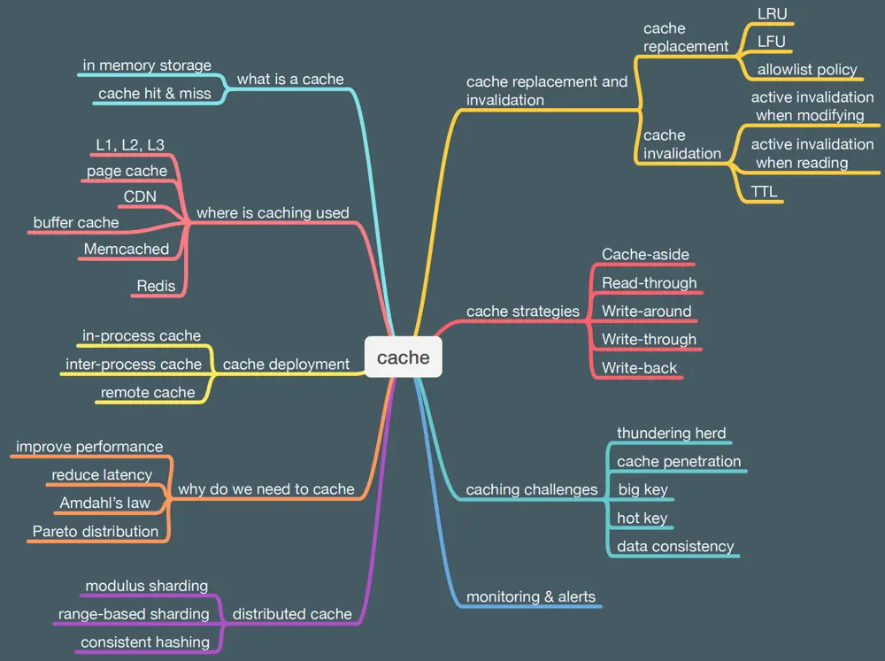

# ByteByteGo System Design 101: Learn Cache

> Copied from <https://github.com/ByteByteGoHq/system-design-101> (CC BY-NC-ND 4.0, by ByteByteGo). Questions and answers are the source's own; nothing was answered or rewritten here.

Made a simple visual guide to help everyone understand the key considerations when designing or using caching systems.

*   What is a cache
*   Why do we need cache
*   Where is cache used
*   Cache deployment
*   Distributed cache
*   Cache replacement and invalidation
*   Cache strategies
*   Caching challenges
*   And more.
