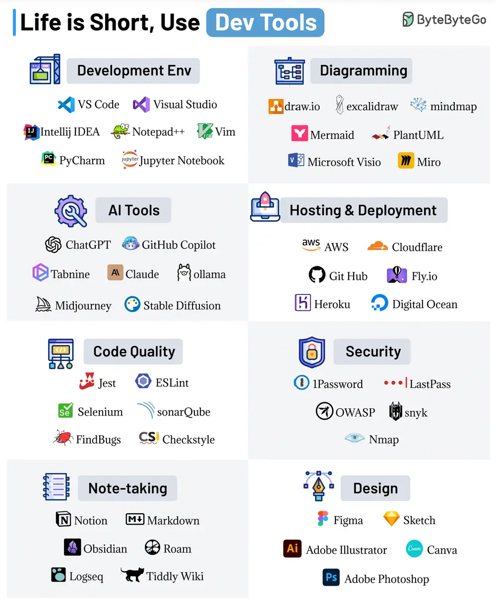

# ByteByteGo System Design 101: Life is Short, Use Dev Tools

> Copied from <https://github.com/ByteByteGoHq/system-design-101> (CC BY-NC-ND 4.0, by ByteByteGo). Questions and answers are the source's own; nothing was answered or rewritten here.

The right dev tool can save you precious time, energy, and perhaps the weekend as well.

Here are our favorite dev tools:

*   **Development Environment**

    A good local dev environment is a force multiplier. Powerful IDEs like VSCode, IntelliJ IDEA, Notepad++, Vim, PyCharm & Jupyter Notebook can make your life easy.

*   **Diagramming**

    Showcase your ideas visually with diagramming tools like DrawIO, Excalidraw, mindmap, Mermaid, PlantUML, Microsoft Visio, and Miro.

*   **AI Tools**

    AI can boost your productivity. Don’t ignore tools like ChatGPT, GitHub Copilot, Tabnine, Claude, Ollama, Midjourney, and Stable Diffusion.

*   **Hosting and Deployment**

    For hosting your applications, explore solutions like AWS, Cloudflare, GitHub, Fly, Heroku, and Digital Ocean.

*   **Code Quality**

    Quality code is a great differentiator. Leverage tools like Jest, ESLint, Selenium, SonarQube, FindBugs, and Checkstyle to ensure top-notch quality.

*   **Security**

    Don’t ignore the security aspects and use solutions like 1Password, LastPass, OWASP, Snyk, and Nmap.

*   **Note-taking**

    Your notes are a reflection of your knowledge. Streamline your note-taking with Notion, Markdown, Obsidian, Roam, Logseq, and Tiddly Wiki.

*   **Design**

    Elevate your visual game with design tools like Figma, Sketch, Adobe Illustrator, Canva, and Adobe Photoshop.
