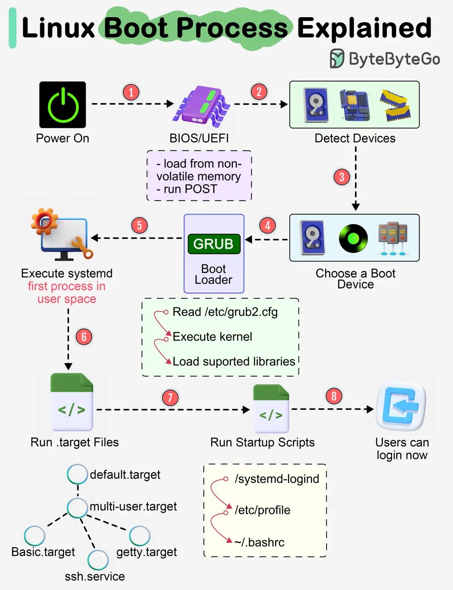

# ByteByteGo System Design 101: Linux Boot Process Explained

> Copied from <https://github.com/ByteByteGoHq/system-design-101> (CC BY-NC-ND 4.0, by ByteByteGo). Questions and answers are the source's own; nothing was answered or rewritten here.

Almost every software engineer has used Linux before, but only a handful know how its Boot Process works. Let's dive in.

## Step 1

When we turn on the power, BIOS (Basic Input/Output System) or UEFI (Unified Extensible Firmware Interface) firmware is loaded from non-volatile memory and executes POST (Power On Self Test).

## Step 2

BIOS/UEFI detects the devices connected to the system, including CPU, RAM, and storage.

## Step 3

Choose a booting device to boot the OS from. This can be the hard drive, the network server, or CD ROM.

## Step 4

BIOS/UEFI runs the boot loader (GRUB), which provides a menu to choose the OS or the kernel functions.

## Step 5

After the kernel is ready, we now switch to the user space. The kernel starts up systemd as the first user-space process, which manages the processes and services, probes all remaining hardware, mounts filesystems, and runs a desktop environment.

## Step 6

systemd activates the default. target unit by default when the system boots. Other analysis units are executed as well.

## Step 7

The system runs a set of startup scripts and configure the environment.

## Step 8

The users are presented with a login window. The system is now ready.
