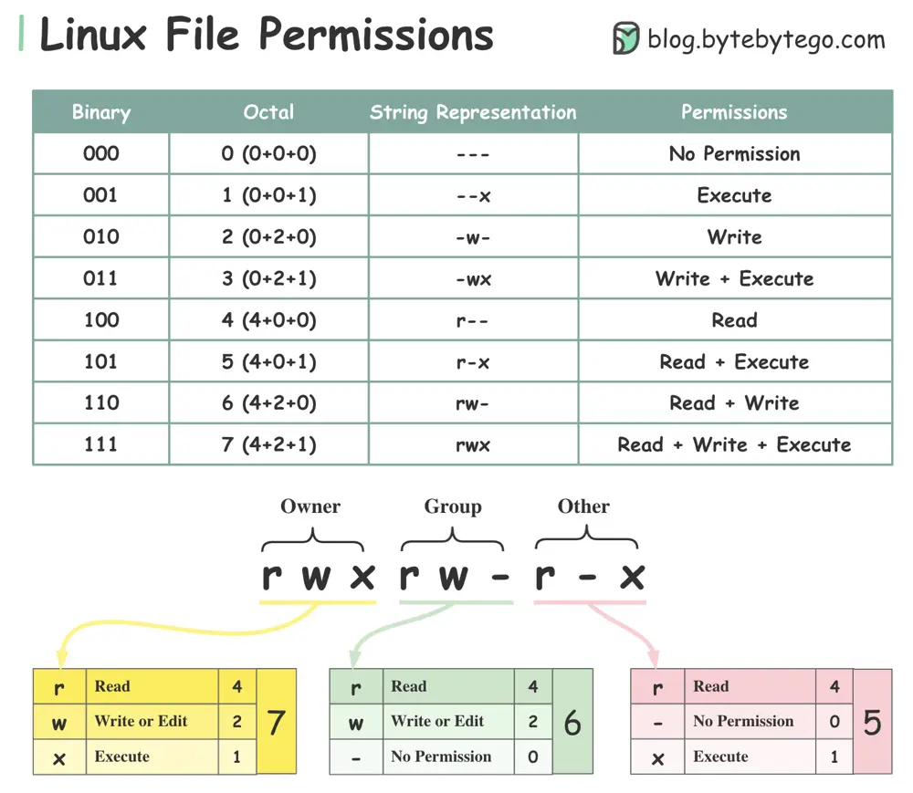

# ByteByteGo System Design 101: Linux File Permissions Illustrated

> Copied from <https://github.com/ByteByteGoHq/system-design-101> (CC BY-NC-ND 4.0, by ByteByteGo). Questions and answers are the source's own; nothing was answered or rewritten here.

## Ownership

Every file or directory is assigned 3 types of owner:

*   **Owner**: the owner is the user who created the file or directory.

*   **Group**: a group can have multiple users. All users in the group have the same permissions to access the file or directory.

*   **Other**: other means those users who are not owners or members of the group.

## Permission

There are only three types of permissions for a file or directory.

*   **Read (r)**: the read permission allows the user to read a file.

*   **Write (w)**: the write permission allows the user to change the content of the file.

*   **Execute (x)**: the execute permission allows a file to be executed.
