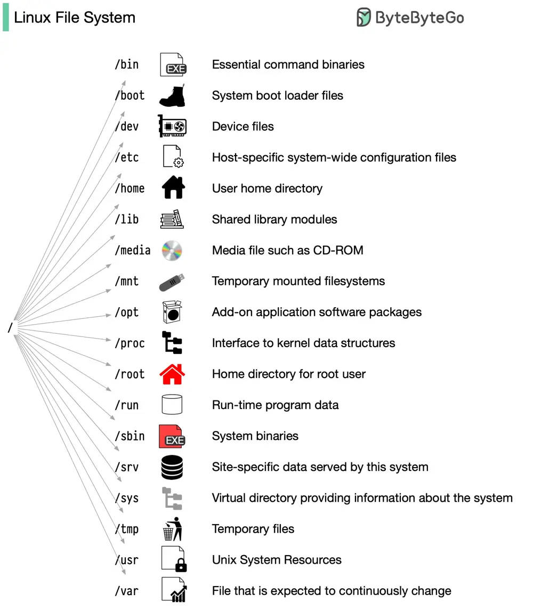

# ByteByteGo System Design 101: Linux File System Explained

> Copied from <https://github.com/ByteByteGoHq/system-design-101> (CC BY-NC-ND 4.0, by ByteByteGo). Questions and answers are the source's own; nothing was answered or rewritten here.

The Linux file system used to resemble an unorganized town where individuals constructed their houses wherever they pleased. However, in 1994, the Filesystem Hierarchy Standard (FHS) was introduced to bring order to the Linux file system.

By implementing a standard like the FHS, software can ensure a consistent layout across various Linux distributions. Nonetheless, not all Linux distributions strictly adhere to this standard. They often incorporate their own unique elements or cater to specific requirements.

To become proficient in this standard, you can begin by exploring. Utilize commands such as "cd" for navigation and "ls" for listing directory contents. Imagine the file system as a tree, starting from the root (/). With time, it will become second nature to you, transforming you into a skilled Linux administrator.
