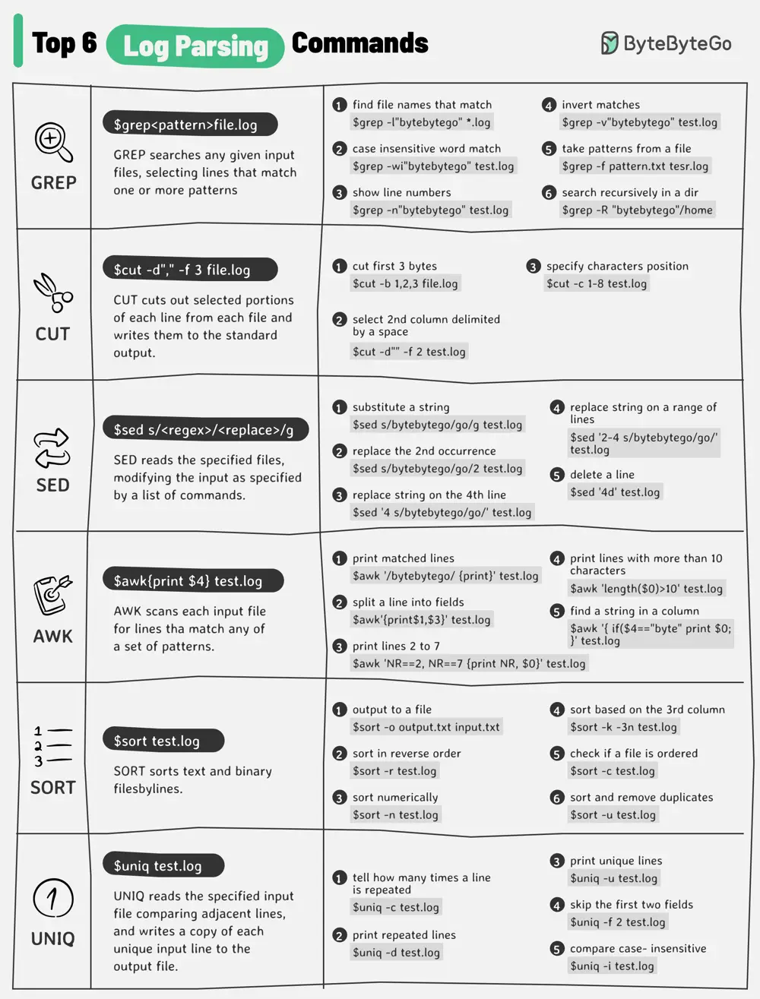

# ByteByteGo System Design 101: Log Parsing Cheat Sheet

> Copied from <https://github.com/ByteByteGoHq/system-design-101> (CC BY-NC-ND 4.0, by ByteByteGo). Questions and answers are the source's own; nothing was answered or rewritten here.




The diagram below lists the top 6 log parsing commands.

## Log Parsing Commands

*   **GREP**

    GREP searches any given input files, selecting lines that match one or more patterns.

*   **CUT**

    CUT cuts out selected portions of each line from each file and writes them to the standard output.

*   **SED**

    SED reads the specified files, modifying the input as specified by a list of commands.

*   **AWK**

    AWK scans each input file for lines that match any of a set of patterns.

*   **SORT**

    SORT sorts text and binary files by lines.

*   **UNIQ**

    UNIQ reads the specified input file comparing adjacent lines and writes a copy of each unique input line to the output file.

These commands are often used in combination to quickly find useful information from the log files. For example, the below commands list the timestamps (column 2) when there is an exception happening for xxService.

```bash
grep “xxService” service.log | grep “Exception” | cut -d” “ -f 2
```
