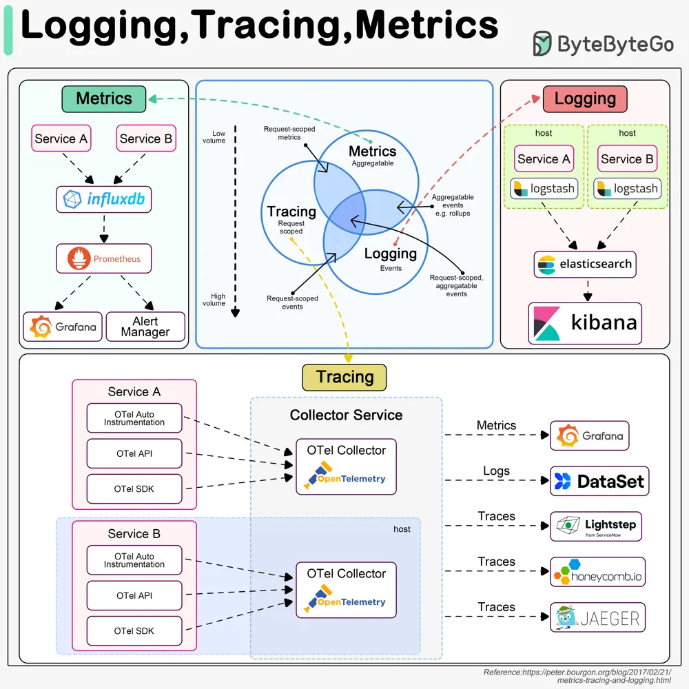

# ByteByteGo System Design 101: Logging, Tracing, and Metrics

> Copied from <https://github.com/ByteByteGoHq/system-design-101> (CC BY-NC-ND 4.0, by ByteByteGo). Questions and answers are the source's own; nothing was answered or rewritten here.

Logging, tracing, and metrics are 3 pillars of system observability. The diagram below shows their definitions and typical architectures.

## Logging

Logging records discrete events in the system. For example, we can record an incoming request or a visit to databases as events. It has the highest volume. ELK (Elastic-Logstash-Kibana) stack is often used to build a log analysis platform. We often define a standardized logging format for different teams to implement, so that we can leverage keywords when searching among massive amounts of logs.

## Tracing

Tracing is usually request-scoped. For example, a user request goes through the API gateway, load balancer, service A, service B, and database, which can be visualized in the tracing systems. This is useful when we are trying to identify the bottlenecks in the system. We use OpenTelemetry to showcase the typical architecture, which unifies the 3 pillars in a single framework.

## Metrics

Metrics are usually aggregatable information from the system. For example, service QPS, API responsiveness, service latency, etc. The raw data is recorded in time-series databases like InfluxDB. Prometheus pulls the data and transforms the data based on pre-defined alerting rules. Then the data is sent to Grafana for display or to the alert manager which then sends out email, SMS, or Slack notifications or alerts.
