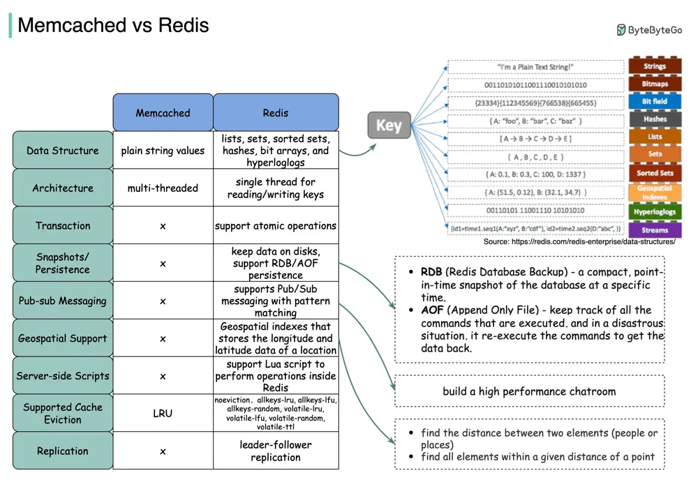

# ByteByteGo System Design 101: Memcached vs Redis

> Copied from <https://github.com/ByteByteGoHq/system-design-101> (CC BY-NC-ND 4.0, by ByteByteGo). Questions and answers are the source's own; nothing was answered or rewritten here.

Popular interview question - what are the differences between Redis and Memcached?

The diagram above illustrates the key differences. The advantages of data structures make Redis a good choice for:

*   Recording the number of clicks and comments for each post (hash)

*   Sorting the commented user list and deduping the users (zset)

*   Caching user behavior history and filtering malicious behaviors (zset, hash)

*   Storing boolean information of extremely large data into small space. For example, login status, membership status. (bitmap)
