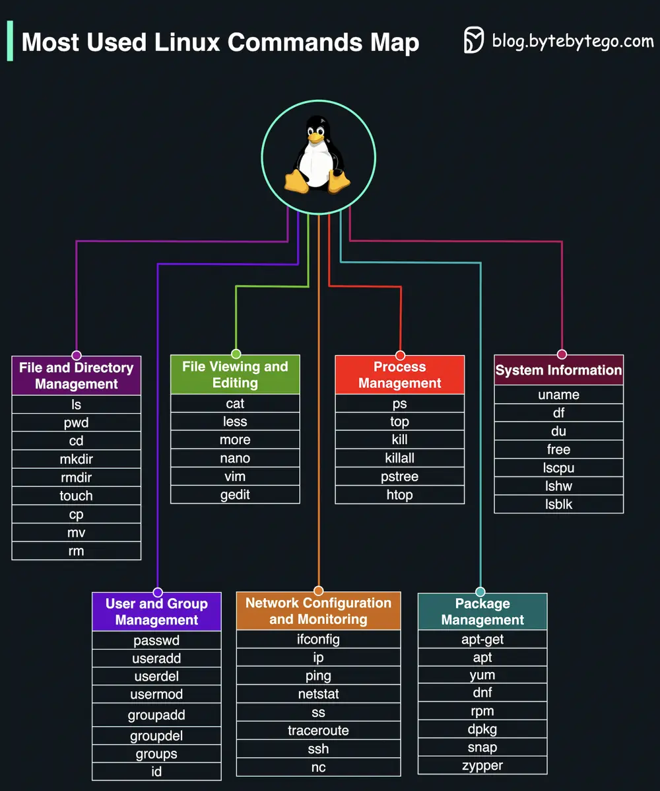

# ByteByteGo System Design 101: Most Used Linux Commands Map

> Copied from <https://github.com/ByteByteGoHq/system-design-101> (CC BY-NC-ND 4.0, by ByteByteGo). Questions and answers are the source's own; nothing was answered or rewritten here.

This map provides a concise overview of the most commonly used Linux commands, categorized by their primary function.

## File and Directory Management

## File Viewing and Editing

## Process Management

## System Information

## User and Group Management

## Network Configuration and Monitoring

## Package Management
