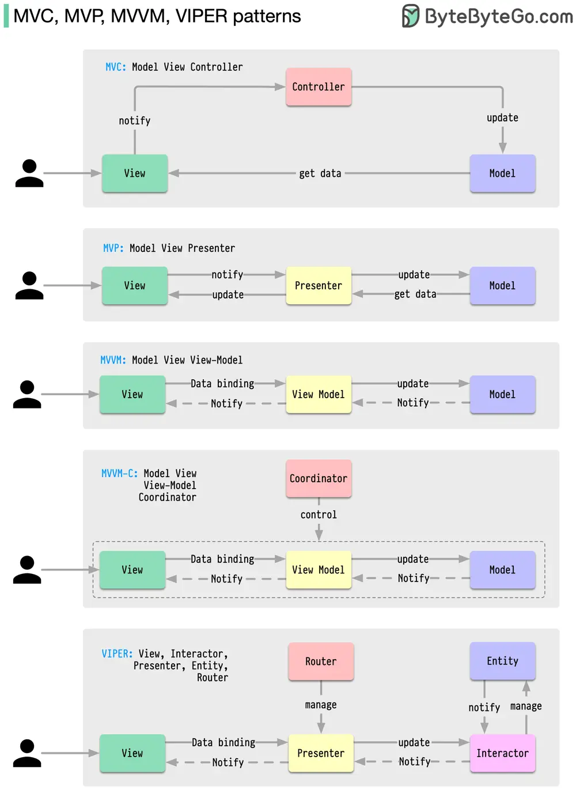

# ByteByteGo System Design 101: MVC, MVP, MVVM, VIPER Patterns

> Copied from <https://github.com/ByteByteGoHq/system-design-101> (CC BY-NC-ND 4.0, by ByteByteGo). Questions and answers are the source's own; nothing was answered or rewritten here.

What distinguishes MVC, MVP, MVVM, MVVM-C, and VIPER architecture patterns from each other?

These architecture patterns are among the most commonly used in app development, whether on iOS or Android platforms. Developers have introduced them to overcome the limitations of earlier patterns. So, how do they differ?

*   MVC, the oldest pattern, dates back almost 50 years

*   Every pattern has a "view" (V) responsible for displaying content and receiving user input

*   Most patterns include a "model" (M) to manage business data

*   "Controller," "presenter," and "view-model" are translators that mediate between the view and the model ("entity" in the VIPER pattern)

*   These translators can be quite complex to write, so various patterns have been proposed to make them more maintainable
