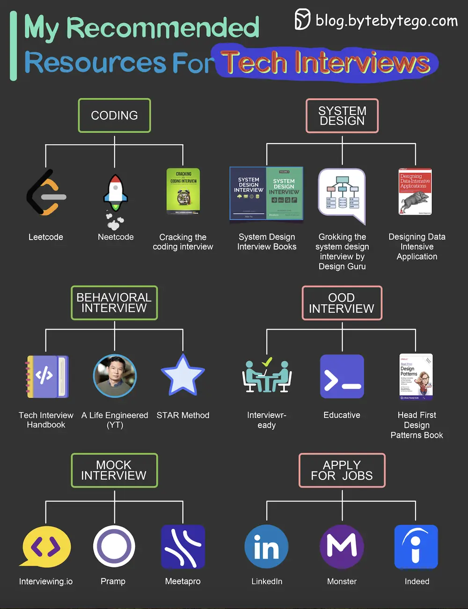

# ByteByteGo System Design 101: Recommended Materials for Technical Interviews

> Copied from <https://github.com/ByteByteGoHq/system-design-101> (CC BY-NC-ND 4.0, by ByteByteGo). Questions and answers are the source's own; nothing was answered or rewritten here.

## Coding

*   Leetcode
*   Cracking the coding interview book
*   Neetcode

## System Design Interview

*   System Design Interview Book 1, 2 by Alex Xu, Sahn Lam
*   Grokking the system design by Design Guru
*   Design Data-intensive Application book

## Behavioral interview

*   Tech Interview Handbook (Github repo)
*   A Life Engineered (YT)
*   STAR method (general method)

## OOD Interview

*   Interviewready
*   OOD by educative
*   Head First Design Patterns Book

## Mock interviews

*   Interviewingio
*   Pramp
*   Meetapro

## Apply for Jobs

*   Linkedin
*   Monster
*   Indeed
