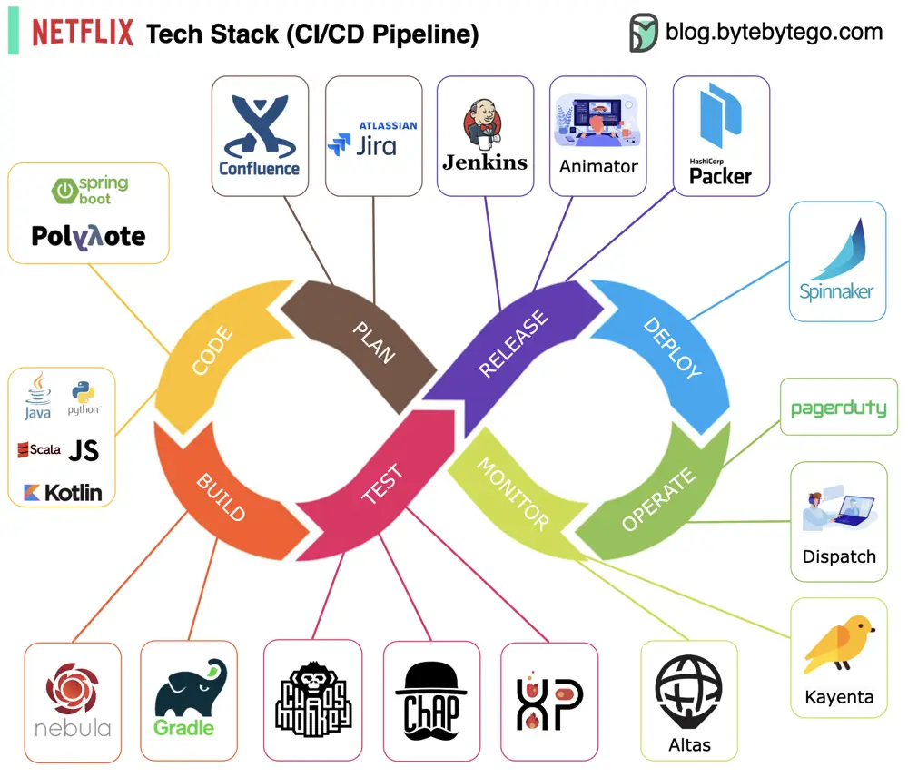

# ByteByteGo System Design 101: Netflix Tech Stack - CI/CD Pipeline

> Copied from <https://github.com/ByteByteGoHq/system-design-101> (CC BY-NC-ND 4.0, by ByteByteGo). Questions and answers are the source's own; nothing was answered or rewritten here.

*   **Planning:** Netflix Engineering uses JIRA for planning and Confluence for documentation.

*   **Coding:** Java is the primary programming language for the backend service, while other languages are used for different use cases.

*   **Build:** Gradle is mainly used for building, and Gradle plugins are built to support various use cases.

*   **Packaging:** Package and dependencies are packed into an Amazon Machine Image (AMI) for release.

*   **Testing:** Testing emphasizes the production culture's focus on building chaos tools.

*   **Deployment:** Netflix uses its self-built Spinnaker for canary rollout deployment.

*   **Monitoring:** The monitoring metrics are centralized in Atlas, and Kayenta is used to detect anomalies.

*   **Incident report:** Incidents are dispatched according to priority, and PagerDuty is used for incident handling.
