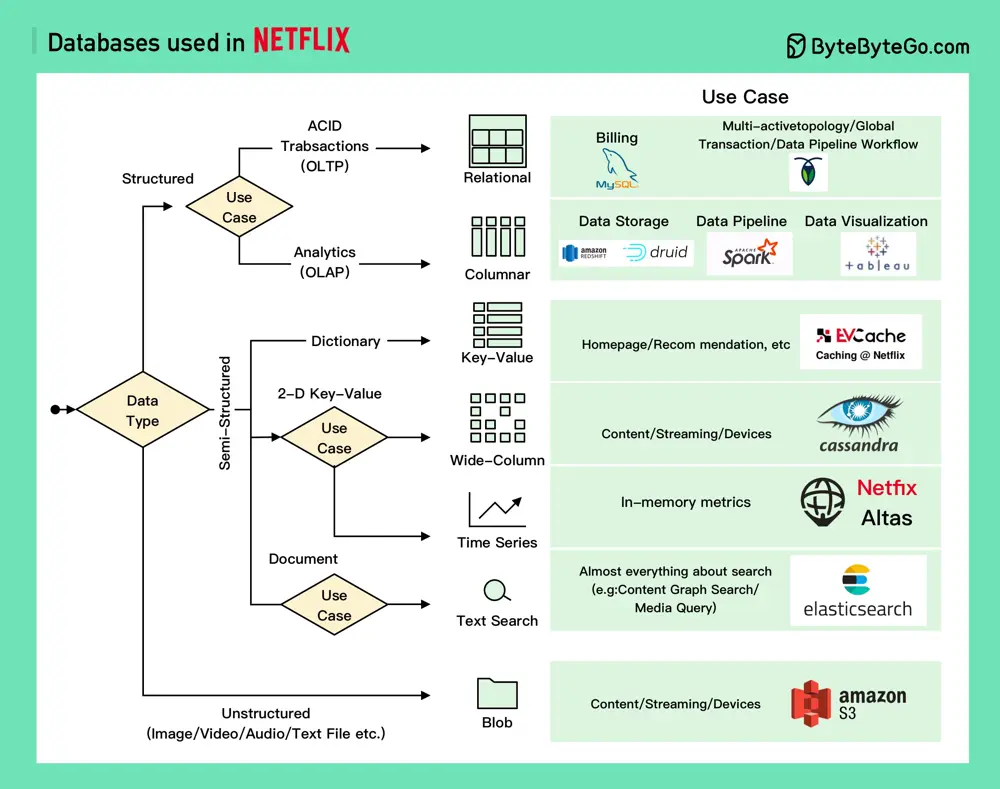

# ByteByteGo System Design 101: Netflix Tech Stack - Databases

> Copied from <https://github.com/ByteByteGoHq/system-design-101> (CC BY-NC-ND 4.0, by ByteByteGo). Questions and answers are the source's own; nothing was answered or rewritten here.

The Netflix Engineering team selects a variety of databases to empower streaming at scale.

*   **Relational databases:** Netflix chooses MySql for billing transactions, subscriptions, taxes, and revenue. They also use CockroachDB to support a multi-region active-active architecture, global transactions, and data pipeline workflows.

*   **Columnar databases:** Netflix primarily uses them for analytics purposes. They utilize Redshift and Druid for structured data storage, Spark and data pipeline processing, and Tableau for data visualization.

*   **Key-value databases:** Netflix mainly uses EVCache built on top of Memcached. EVCache has been with Netflix for over 10 years and is used for most services, caching various data such as the Netflix Homepage and Personal Recommendations.

*   **Wide-column databases:** Cassandra is usually the default choice at Netflix. They use it for almost everything, including Video/Actor information, User Data, Device information, and Viewing History.

*   **Time-series databases:** Netflix built an open-source in-memory database called Atlas for metrics storage and aggregation.

*   **Unstructured data:** S3 is the default choice and stores almost everything related to Image/Video/Metrics/Log files. Apache Iceberg is also used with S3 for big data storage.

If you work for a large company and wish to discuss your company's technology stack, feel free to get in touch with me. By default, all communications will be treated as anonymous.
