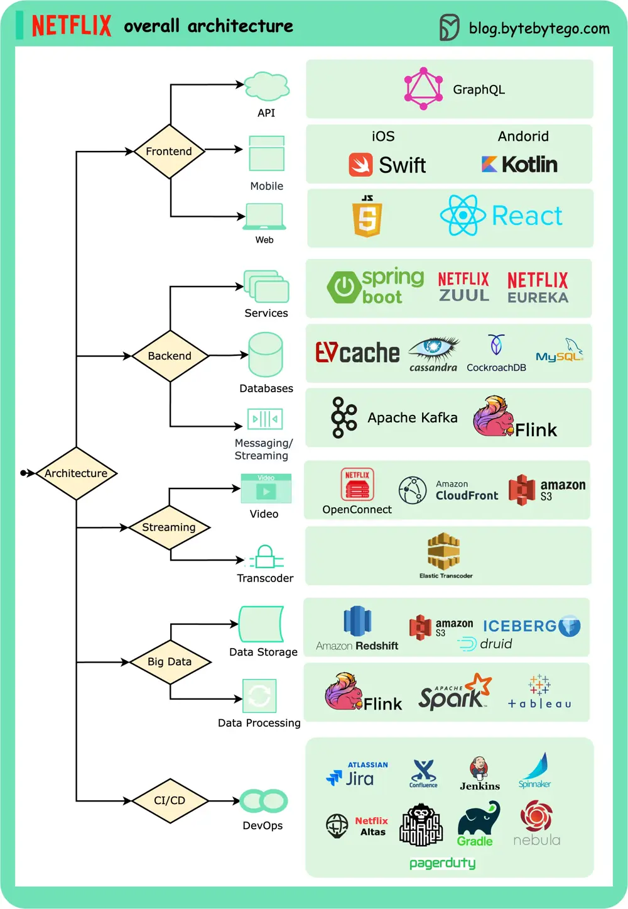

# ByteByteGo System Design 101: Netflix's Overall Architecture

> Copied from <https://github.com/ByteByteGoHq/system-design-101> (CC BY-NC-ND 4.0, by ByteByteGo). Questions and answers are the source's own; nothing was answered or rewritten here.

This post is based on research from many Netflix engineering blogs and open-source projects. If you come across any inaccuracies, please feel free to inform us.

Mobile and web: Netflix has adopted Swift and Kotlin to build native mobile apps. For its web application, it uses React.

Frontend/server communication: Netflix uses GraphQL.

Backend services: Netflix relies on ZUUL, Eureka, the Spring Boot framework, and other technologies.

Databases: Netflix utilizes EV cache, Cassandra, CockroachDB, and other databases.

Messaging/streaming: Netflix employs Apache Kafka and Fink for messaging and streaming purposes.

Video storage: Netflix uses S3 and Open Connect for video storage.

Data processing: Netflix utilizes Flink and Spark for data processing, which is then visualized using Tableau. Redshift is used for processing structured data warehouse information.

CI/CD: Netflix employs various tools such as JIRA, Confluence, PagerDuty, Jenkins, Gradle, Chaos Monkey, Spinnaker, Altas, and more for CI/CD processes.
