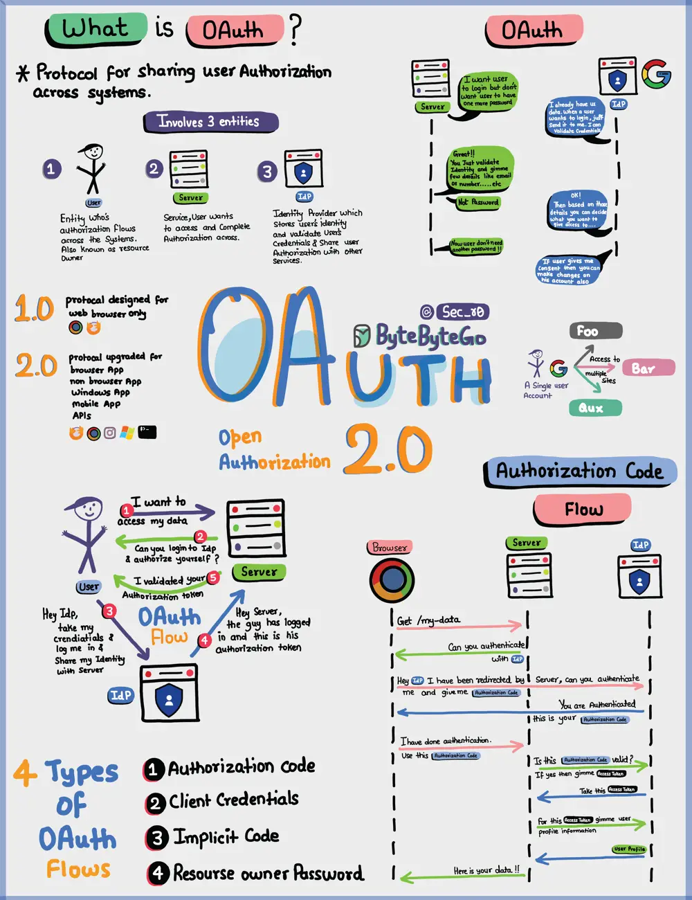

# ByteByteGo System Design 101: OAuth 2.0 Explained With Simple Terms

> Copied from <https://github.com/ByteByteGoHq/system-design-101> (CC BY-NC-ND 4.0, by ByteByteGo). Questions and answers are the source's own; nothing was answered or rewritten here.

OAuth 2.0 is a powerful and secure framework that allows different applications to securely interact with each other on behalf of users without sharing sensitive credentials.

The entities involved in OAuth are the User, the Server, and the Identity Provider (IDP).

## What Can an OAuth Token Do?

When you use OAuth, you get an OAuth token that represents your identity and permissions. This token can do a few important things:

*   Single Sign-On (SSO): With an OAuth token, you can log into multiple services or apps using just one login, making life easier and safer.

*   Authorization Across Systems: The OAuth token allows you to share your authorization or access rights across various systems, so you don't have to log in separately everywhere.

*   Accessing User Profile: Apps with an OAuth token can access certain parts of your user profile that you allow, but they won't see everything.

Remember, OAuth 2.0 is all about keeping you and your data safe while making your online experiences seamless and hassle-free across different applications and services.
