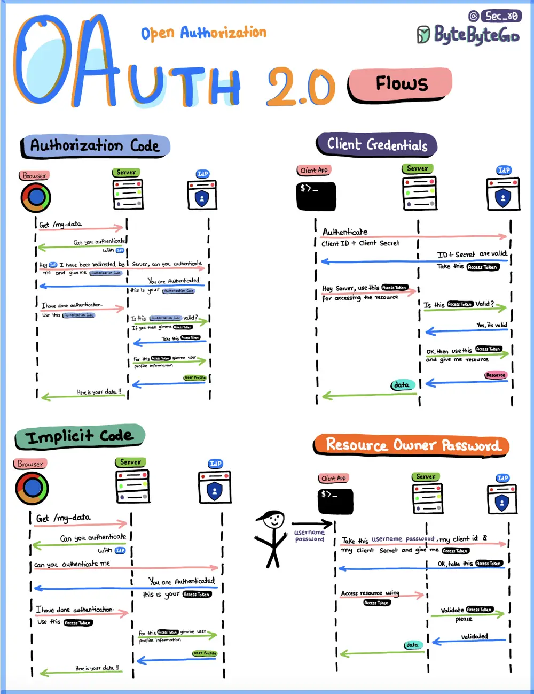

# ByteByteGo System Design 101: OAuth 2.0 Flows

> Copied from <https://github.com/ByteByteGoHq/system-design-101> (CC BY-NC-ND 4.0, by ByteByteGo). Questions and answers are the source's own; nothing was answered or rewritten here.

## Authorization Code Flow

The most common OAuth flow. After user authentication, the client receives an authorization code and exchanges it for an access token and refresh token.

## Client Credentials Flow

Designed for single-page applications. The access token is returned directly to the client without an intermediate authorization code.

## Implicit Code Flow

Designed for single-page applications. The access token is returned directly to the client without an intermediate authorization code.

## Resource Owner Password Grant Flow

Allows users to provide their username and password directly to the client, which then exchanges them for an access token.
