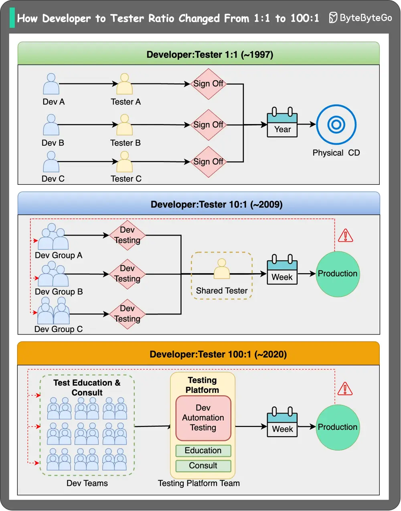

# ByteByteGo System Design 101: Paradigm Shift: Developer to Tester Ratio

> Copied from <https://github.com/ByteByteGoHq/system-design-101> (CC BY-NC-ND 4.0, by ByteByteGo). Questions and answers are the source's own; nothing was answered or rewritten here.

This post is inspired by the article "The Paradigm Shifts with Different Dev:Test Ratios" by [Carlos Arguelles](https://www.linkedin.com/in/ACoAAABj60kByWwNDRyWLdeCCmaKZYUHd4LynqQ). I highly recommend that you read the original article [here](https://lnkd.in/ehbZzZck).

## 1:1 ratio (~1997)

Software used to be burned onto physical CDs and delivered to customers. The development process was waterfall-style, builds were certified, and versions were released roughly every three years.

If you had a bug, that bug would live forever. It wasn’t until years later that companies added the ability for software to ping the internet for updates and automatically install them.

## 10:1 ratio (~2009)

Around 2009, the release-to-production speed increased significantly. Patches could be installed within weeks, and the agile movement, along with iteration-driven development, changed the development process.

For example, at Amazon, the web services are mainly developed and tested by the developers. They are also responsible for dealing with production issues, and testing resources are stretched thin (10:1 ratio).

## 100:1 ratio (~2020)

Around 2015, big tech companies like Google and Microsoft removed SDET or SETI titles, and Amazon slowed down the hiring of SDETs.

But how is this going to work for big tech in terms of testing?

Firstly, the testing aspect of the software has shifted towards highly scalable, standardized testing tools. These tools have been widely adopted by developers for building their own automated tests.

Secondly, testing knowledge is disseminated through education and consulting.

Together, these factors have facilitated a smooth transition to the 100:1 testing ratio we see today.
