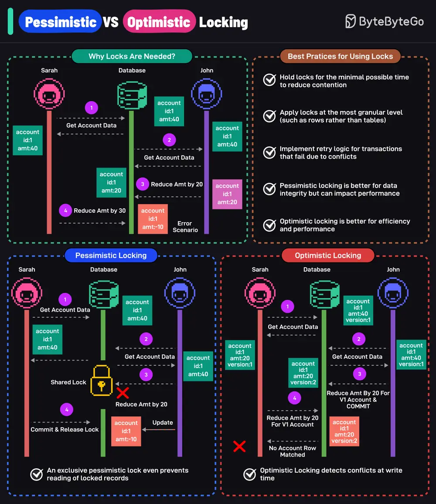

# ByteByteGo System Design 101: Pessimistic vs Optimistic Locking

> Copied from <https://github.com/ByteByteGoHq/system-design-101> (CC BY-NC-ND 4.0, by ByteByteGo). Questions and answers are the source's own; nothing was answered or rewritten here.

Locks are essential to maintain data consistency and integrity in multi-user environments. They prevent simultaneous modifications that can lead to data inconsistencies.

Pessimistic locking assumes conflicts will occur and locks the data before any changes are made. It prevents other users from accessing and updating the data until the lock is released.

Optimistic locking assumes conflicts are rare. It allows multiple users to access data simultaneously and checks for conflicts when changes are committed. If a conflict is detected, the operation is rolled back.

## Best Practices

Here are some best practices to consider:

*   Hold locks for the minimum possible time to reduce contention.
*   Apply locks at the most granular level such as rows rather than tables.
*   Implement retry logic for transactions that fail due to conflicts.
*   Pessimistic locking is better for data integrity but can impact performance.
*   Optimistic locking is better for efficiency and performance.
