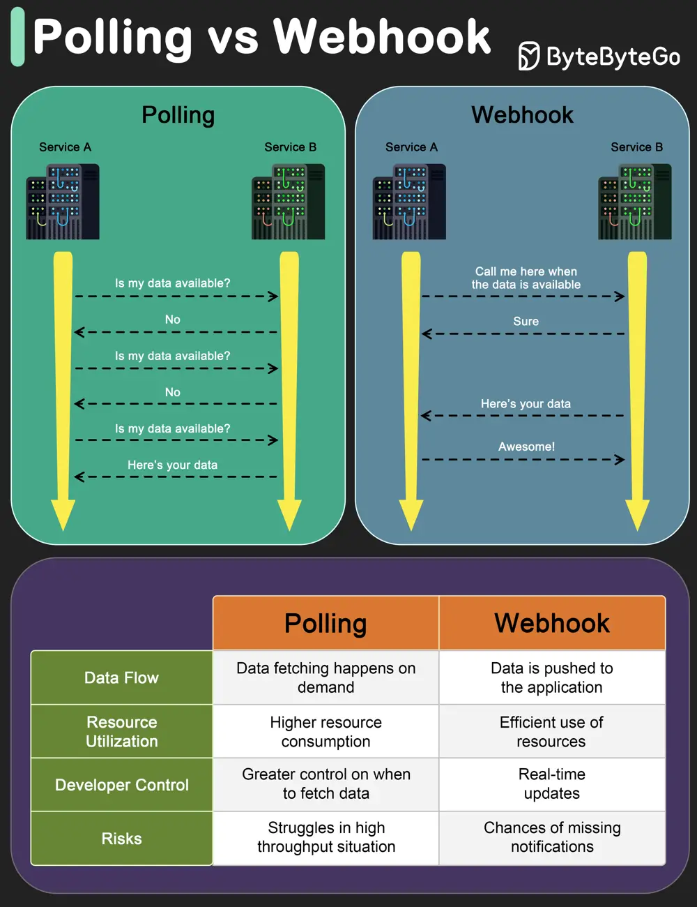

# ByteByteGo System Design 101: Polling vs Webhooks

> Copied from <https://github.com/ByteByteGoHq/system-design-101> (CC BY-NC-ND 4.0, by ByteByteGo). Questions and answers are the source's own; nothing was answered or rewritten here.

## Polling

Polling involves repeatedly checking the external service or endpoint at fixed intervals to retrieve updated information.

It’s like constantly asking, “Do you have something new for me?” even where there might not be any update.

This approach is resource-intensive and inefficient.

Also, you get updates only when you ask for it, thereby missing any real-time information.

However, developers have more control over when and how the data is fetched.

## Webhooks

Webhooks are like having a built-in notification system.

You don’t continuously ask for information.

Instead you create an endpoint in your application server and provide it as a callback to the external service (such as a payment processor or a shipping vendor)

Every time something interesting happens, the external service calls the endpoint and provides the information.

This makes webhooks ideal for dealing with real-time updates because data is pushed to your application as soon as it’s available.

So, when to use Polling or Webhook?

Polling is a solid option when there is some infrastructural limitation that prevents the use of webhooks. Also, with webhooks there is a risk of missed notifications due to network issues, hence proper retry mechanisms are needed.

Webhooks are recommended for applications that need instant data delivery. Also, webhooks are efficient in terms of resource utilization especially in high throughput environments.
