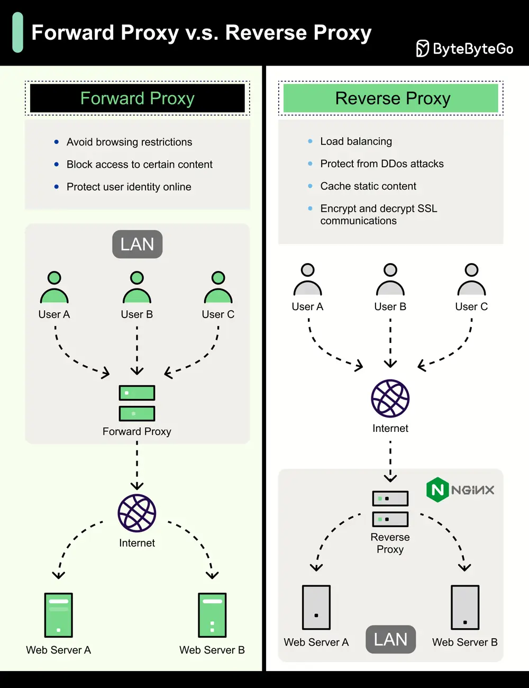

# ByteByteGo System Design 101: Proxy vs Reverse Proxy

> Copied from <https://github.com/ByteByteGoHq/system-design-101> (CC BY-NC-ND 4.0, by ByteByteGo). Questions and answers are the source's own; nothing was answered or rewritten here.

A forward proxy is a server that sits between user devices and the internet. A forward proxy is commonly used for:

*   **Protect clients**
*   **Avoid browsing restrictions**
*   **Block access to certain content**

A reverse proxy is a server that accepts a request from the client, forwards the request to web servers, and returns the results to the client as if the proxy server had processed the request. A reverse proxy is good for:

*   **Protect servers**
*   **Load balancing**
*   **Cache static contents**
*   **Encrypt and decrypt SSL communications**
