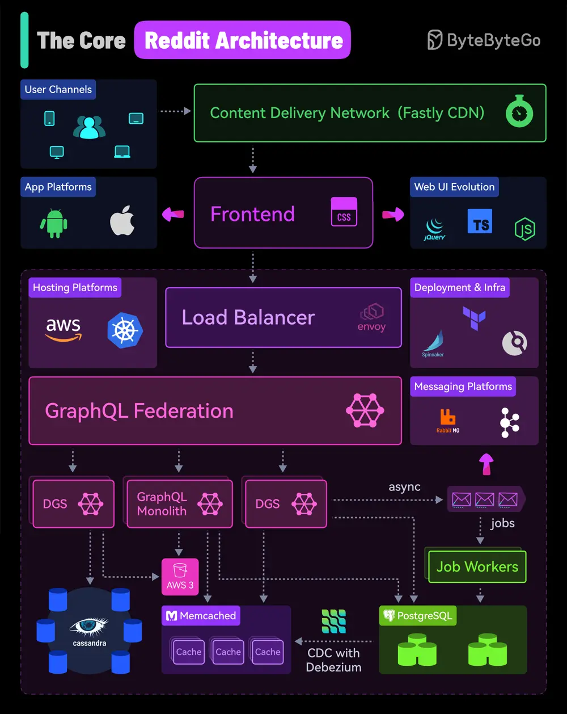

# ByteByteGo System Design 101: Reddit's Core Architecture

> Copied from <https://github.com/ByteByteGoHq/system-design-101> (CC BY-NC-ND 4.0, by ByteByteGo). Questions and answers are the source's own; nothing was answered or rewritten here.

A quick look at Reddit’s Core Architecture that helps it serve over 1 billion users every month.

This information is based on research from many Reddit engineering blogs. But since architecture is ever-evolving, things might have changed in some aspects.

The main points of Reddit’s architecture are as follows:

*   Reddit uses a Content Delivery Network (CDN) from Fastly as a front for the application.
*   Reddit started using jQuery in early 2009. Later on, they started using Typescript and have now moved to modern Node.js frameworks. Over the years, Reddit has also built mobile apps for Android and iOS.
*   Within the application stack, the load balancer sits in front and routes incoming requests to the appropriate services.
*   Reddit started as a Python-based monolithic application but has since started moving to microservices built using Go.
*   Reddit heavily uses GraphQL for its API layer. In early 2021, they started moving to GraphQL Federation, which is a way to combine multiple smaller GraphQL APIs known as Domain Graph Services (DGS). In 2022, the GraphQL team at Reddit added several new Go subgraphs for core Reddit entities thereby splitting the GraphQL monolith.
*   From a data storage point of view, Reddit relies on Postgres for its core data model. To reduce the load on the database, they use memcached in front of Postgres. Also, they use Cassandra quite heavily for new features mainly because of its resiliency and availability properties.
*   To support data replication and maintain cache consistency, Reddit uses Debezium to run a Change Data Capture process.
*   Expensive operations such as a user voting or submitting a link are deferred to an async job queue via RabbitMQ and processed by job workers. For content safety checks and moderation, they use Kafka to transfer data in real-time to run rules over them.
*   Reddit uses AWS and Kubernetes as the hosting platform for its various apps and internal services.
*   For deployment and infrastructure, they use Spinnaker, Drone CI, and Terraform.
