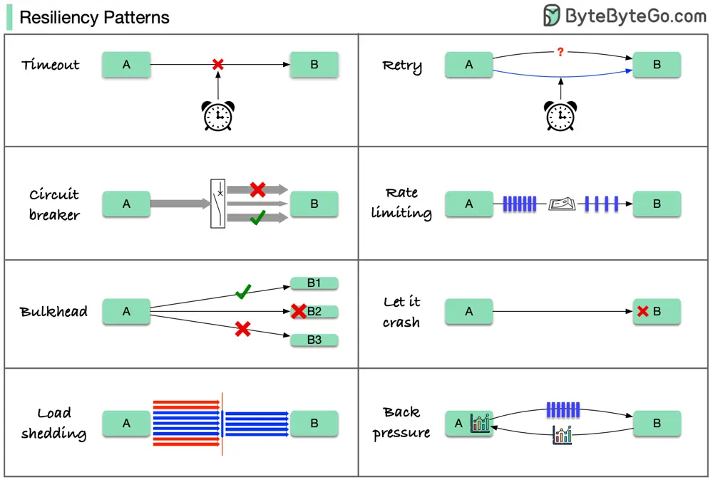

# ByteByteGo System Design 101: Resiliency Patterns

> Copied from <https://github.com/ByteByteGoHq/system-design-101> (CC BY-NC-ND 4.0, by ByteByteGo). Questions and answers are the source's own; nothing was answered or rewritten here.

Have you noticed that the largest incidents are usually caused by something very small?

A minor error starts the snowball effect that keeps building up. Suddenly, everything is down.

Here are 8 cloud design patterns to reduce the damage done by failures.

*   Timeout
*   Retry
*   Circuit breaker
*   Rate limiting
*   Load shedding
*   Bulkhead
*   Back pressure
*   Let it crash

These patterns are usually not used alone. To apply them effectively, we need to understand why we need them, how they work, and their limitations.
