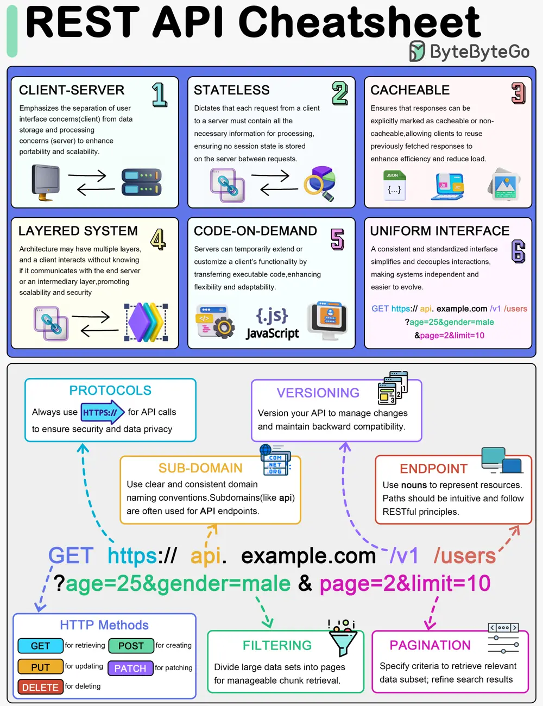

# ByteByteGo System Design 101: REST API Cheatsheet

> Copied from <https://github.com/ByteByteGoHq/system-design-101> (CC BY-NC-ND 4.0, by ByteByteGo). Questions and answers are the source's own; nothing was answered or rewritten here.

This guide is designed to help you understand the world of RESTful APIs in a clear and engaging way.

What's inside:

*   An exploration of the six fundamental principles of REST API design.
*   Insights into key components such as HTTP methods, protocols, versioning, and more.
*   A special focus on practical aspects like pagination, filtering, and endpoint design.

Whether you're beginning your API journey or looking to refresh your knowledge, this blog and cheat sheet combo is the perfect toolkit for success.
